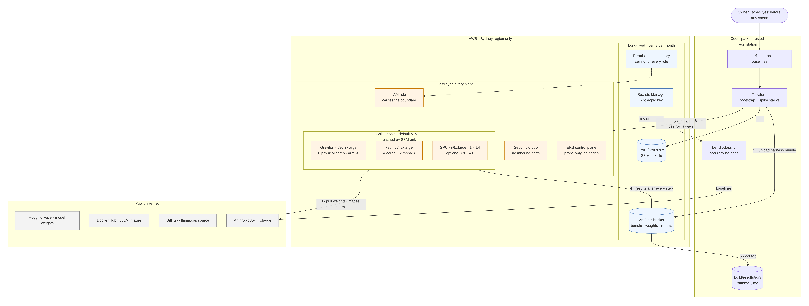
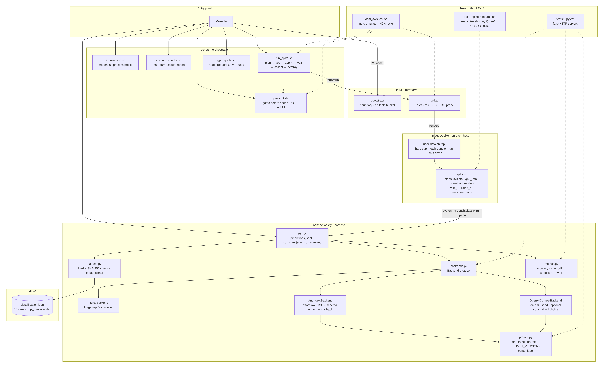
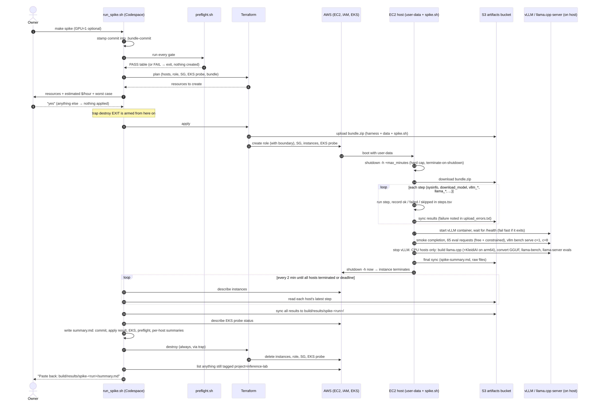
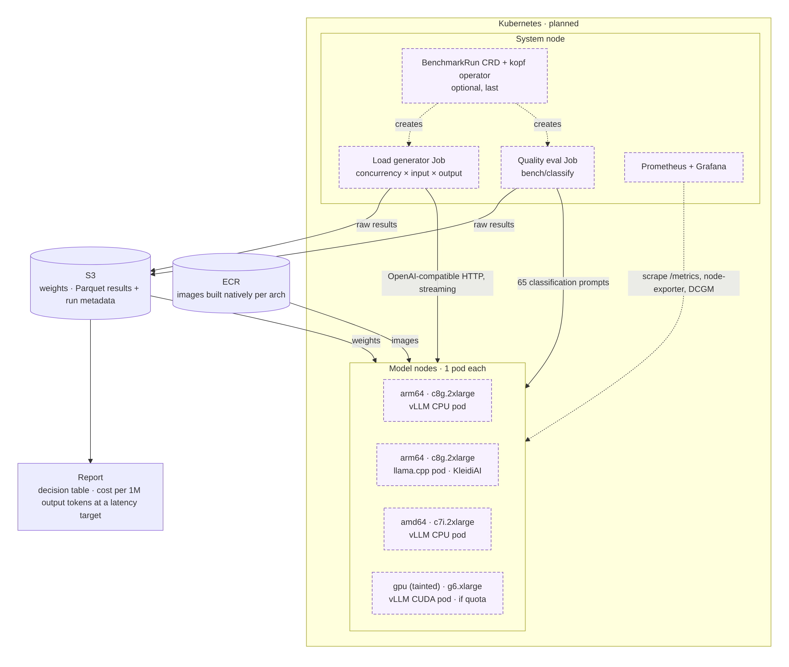
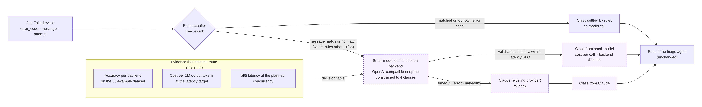
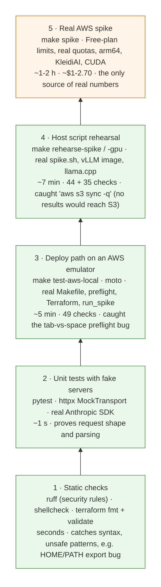

# Design: inference-lab

| | |
|---|---|
| **Question** | Which hardware and runtime should serve the cheap, high-volume step of an AI agent, and at what latency, throughput, cost and accuracy? |
| **Headline comparison** | Arm (AWS Graviton) vs x86 CPU at the same instance size and price class; one GPU as a reference |
| **Owner** | Praveen Nishchal |
| **Status (2026-11-14)** | Day 1 of 4. Built and tested locally end to end; first AWS run pending. See [§2 Status](#2-status-what-is-measured-built-and-planned) |
| **Related** | [ADRs](adr/) · [Cost log](cost-log.md) · [AI-in-the-SDLC log](ai-sdlc-log.md) · [Diagrams](diagrams/) · [pipeline-triage-agent](https://github.com/praveennish/pipeline-triage-agent) |

**How to read this document.** Sections 1 to 3 explain the problem and the system in plain words;
a new engineer should read those first. Sections 4 to 11 explain each part and why it was built
that way. Sections 12 to 16 cover testing, cost, risks and what comes next. Section 17 is a set of
interview-style questions with answers. Section 18 is a glossary: if a word is unfamiliar
(TTFT, KV cache, GGUF, vCPU, KleidiAI…), look there.

**One rule runs through everything:** no number appears in a report unless it was computed from a
raw result file. Where this document gives a formula with example values, the values are marked
*illustrative*.

## Contents

1. [The problem in plain words](#1-the-problem-in-plain-words)
2. [Status: what is measured, built and planned](#2-status-what-is-measured-built-and-planned)
3. [Architecture: the end-to-end picture](#3-architecture-the-end-to-end-picture)
4. [Components: what each part of the code does](#4-components-what-each-part-of-the-code-does)
5. [One run, step by step (sequence)](#5-one-run-step-by-step-sequence)
6. [The measurement method: how the comparison is kept fair](#6-the-measurement-method-how-the-comparison-is-kept-fair)
7. [Accuracy: the classification eval](#7-accuracy-the-classification-eval)
8. [Serving runtimes: vLLM, llama.cpp, and the GPU](#8-serving-runtimes-vllm-llamacpp-and-the-gpu)
9. [Infrastructure, security and the account's constraints](#9-infrastructure-security-and-the-accounts-constraints)
10. [Target architecture: Kubernetes (Day 2 to 4)](#10-target-architecture-kubernetes-day-2-to-4)
11. [Closing the loop: the router in pipeline-triage-agent](#11-closing-the-loop-the-router-in-pipeline-triage-agent)
12. [Reliability: what can go wrong and what happens](#12-reliability-what-can-go-wrong-and-what-happens)
13. [Testing and verification](#13-testing-and-verification)
14. [Cost](#14-cost)
15. [Decisions and rejected alternatives](#15-decisions-and-rejected-alternatives)
16. [Threats to validity, limits and next steps](#16-threats-to-validity-limits-and-next-steps)
17. [Interview deep dive: questions and answers](#17-interview-deep-dive-questions-and-answers)
18. [Glossary](#18-glossary)

---

## 1. The problem in plain words

### 1.1 The agent this serves

[pipeline-triage-agent](https://github.com/praveennish/pipeline-triage-agent) is an AI agent that
looks at failed data-ingestion jobs. Its **first step** decides which of four classes a failure
belongs to:

| Class | Meaning | What happens next |
|---|---|---|
| `cloud_outage` | A temporary cloud problem: throttling, a 5xx error, a network reset | Retry the job |
| `user_input_error` | The producer sent something wrong: missing file, wrong schema | Send the producer a message |
| `unsupported_transformation` | The input is valid but the platform cannot handle it yet | The agent proposes a code change |
| `unknown` | None of the above can be told from the input | The agent investigates |

Today this step is done by **deterministic rules** (free and exact), with Claude used when the
agent needs judgement. The rules get **54 of 65** examples right on the shared dataset (0.83).

### 1.2 Why this question matters

Classification is the **cheap, high-volume** step: every failure goes through it, the input is
short, and the answer is one word. Sending every one of these to a large hosted model is
expensive and adds a network dependency. A **small open model** (here Qwen2.5-1.5B-Instruct,
Apache-2.0) served on our own hardware might do it well enough, much more cheaply. But:

- **Which hardware?** Arm CPUs (AWS Graviton) are cheaper per hour than comparable x86 CPUs, but is
  that still true per token, at a latency we can accept?
- **Which runtime?** vLLM (a production serving engine) or llama.cpp (a lean C++ engine with
  Arm-optimised kernels)?
- **Is it accurate enough?** A fast model that picks the wrong class is worse than the free rules.

### 1.3 What "done" means

1. A **fair, reproducible method** (§6).
2. **Latency, throughput and cost per million output tokens at a stated latency target**, per
   backend.
3. **Accuracy next to speed** for every backend, compared with the rules (0.83) and Claude.
4. **A decision table:** which backend serves this step, at what concurrency, and when to fall
   back to Claude, with threats to validity stated.
5. **A closed loop:** the router change in pipeline-triage-agent (§11).
6. **Discipline:** compute destroyed every night, spend inside the remaining credit, every number
   traceable to a raw file.

### 1.4 Non-goals

- Training or fine-tuning models.
- Large models (7B+). The step needs a short answer; method matters more than model size.
- Multi-region or production deployment. This is a measurement lab with a production-shaped design.

---

## 2. Status: what is measured, built and planned

Be precise about this in any conversation: **built and tested** is not the same as **measured on
AWS**.

| Area | State | Evidence |
|---|---|---|
| Rules baseline | **Measured: 54/65 (0.83), macro-F1 0.81** | `results/baselines-20261111/` (raw predictions) |
| Claude baselines (Opus 5.5, Sonnet 5.5) | Built; run in the Codespace with `make baselines` | Request shape tested against fake servers |
| Accuracy harness (`bench/classify`) | Built and tested | 11 unit tests |
| AWS deploy path (bootstrap, preflight, spike, destroy) | Built and tested on an AWS emulator | `make test-aws-local`: 49/49 checks |
| Host script (`spike.sh`): vLLM, llama.cpp, evals, bench | Built and **run for real locally** on x86 with a tiny model | `make rehearse-spike`: 44/44; GPU branch: 35/35 |
| vLLM images | **Verified on Docker Hub**: CPU and CUDA images are multi-arch (arm64 + amd64) | ADR 0002 |
| First AWS spike (Graviton + x86) | Ready; waiting on the owner's run | `make spike` |
| GPU reference (g6.xlarge) | Built; waiting on the G and VT quota | `make gpu-quota-request`, ADR 0007 |
| Kubernetes, load generator, full matrix, report | Planned (Day 2 to 4) | §10 |

---

## 3. Architecture: the end-to-end picture



### 3.1 The two-minute version (talk track)

> "Everything is driven from one trusted workstation, a GitHub Codespace, with one command per
> stage. Before spending anything, a preflight checks credentials, region, quotas and that nothing
> is left running. Terraform then creates two kinds of resources in the Sydney region. A few are
> long-lived and nearly free: a permissions boundary, an artifacts bucket, and the Terraform state
> reused from the triage project. Everything that costs by the hour (one Graviton host, one x86
> host, optionally one GPU host, and an EKS probe) is created for the run and destroyed after it,
> always, even on failure.
>
> Each host boots, downloads the harness bundle from S3, and runs the same script: it serves the
> same model in BF16 through the official vLLM image, runs the same 65-example accuracy eval and a
> quick throughput probe, and on CPU hosts also builds llama.cpp and compares it with and without
> Arm's KleidiAI kernels. Results are uploaded after every step, so a crash loses at most one step.
> The hosts terminate themselves; the workstation collects the results into one summary file and
> destroys everything. Claude baselines run from the workstation against the Anthropic API."

### 3.2 The diagram, region by region

**Codespace (trusted workstation).** All commands start here. Why not GitHub Actions? An
organisation policy (an SCP) blocks the IAM OIDC provider that Actions would need to reach AWS, so
deploys run from the Codespace with short-lived credentials (ADR 0005).

| Element | Responsibility |
|---|---|
| `make` targets | One command per stage; each writes its own results file |
| Terraform | Creates and destroys AWS resources (two stacks: `bootstrap`, `spike`) |
| `bench/classify` | The accuracy harness: same prompt, same dataset, every backend |
| `profile inference-lab` | AWS credentials through `credential_process`: refreshed automatically, never exported as environment variables (exported ones freeze after ~15 minutes and a long run fails halfway) |
| `build/results/<run>/summary.md` | The one file the owner pastes back |

**AWS, long-lived (cents per month).**

| Element | Why it exists |
|---|---|
| Terraform state bucket (reused) | Shared with pipeline-triage-agent; separate keys under `inference-lab/`; `use_lockfile` prevents two applies at once |
| Permissions boundary | The ceiling for every role this project creates: allowed services in Sydney only, explicit deny elsewhere, `PassRole` only for `/inference-lab/` roles. A role can never be more powerful than this, even if its own policy is too broad |
| Artifacts bucket | Harness bundle, model weights (downloaded once), raw results. Versioned, encrypted, private |
| Secrets Manager | The Anthropic key, read at run time; never in code or environment |

**AWS, destroyed every night.**

| Element | Why it is built this way |
|---|---|
| IAM role + instance profile | Hosts read and write only the bucket prefixes they need; Session Manager access. Carries the boundary |
| Security group | **No inbound ports.** Hosts are reached through SSM Session Manager, so there are no SSH keys to manage or leak |
| Graviton host `c8g.2xlarge` | 8 vCPU = **8 physical cores** (Graviton has no simultaneous multithreading) |
| x86 host `c7i.2xlarge` | 8 vCPU = **4 physical cores × 2 hyperthreads** |
| GPU host `g6.xlarge` (optional) | 1 × NVIDIA L4 (24 GB), on AWS's Deep Learning Base GPU image |
| EKS control plane (probe) | No nodes. Its only job is to answer "does this Free-plan account allow EKS?" to decide Day 2 (ADR 0003) |

**Public internet.** Hugging Face (model weights, downloaded once per revision then served from
S3), Docker Hub (official vLLM images), GitHub (llama.cpp source at a release tag), Anthropic API
(Claude baselines).

### 3.3 Guarantees the design gives

| Guarantee | How |
|---|---|
| Nothing is spent without the owner's "yes" | `run_spike.sh` shows resources and estimated cost, then waits for typed `yes` |
| Nothing survives the night | `trap destroy EXIT` once the apply starts; hosts power off and **terminate** after a hard cap even if the workstation disappears; `make leftovers` lists anything still tagged |
| Every number is traceable | Each result records the git commit, dataset SHA-256, prompt version, model revision, image digest and host details |
| A crash loses at most one step | Results are synced to S3 after every step |
| No role can escalate | Permissions boundary on every role; no inbound network; IMDSv2 required |

---

## 4. Components: what each part of the code does



The code is small (about 2,000 lines) and split by **where it runs**:

| Folder | Runs on | Language | Job |
|---|---|---|---|
| `Makefile` | Codespace | make | Entry points |
| `scripts/` | Codespace | bash | Orchestration: credentials, account checks, preflight, the spike run, GPU quota |
| `infra/` | Codespace → AWS | Terraform | `bootstrap/` (long-lived) and `spike/` (nightly) |
| `images/spike/` | Each EC2 host | bash | `user-data.sh.tftpl` (boot) and `spike.sh` (the work) |
| `bench/classify/` | Codespace and each host | Python 3.12 | Accuracy harness |
| `data/` | — | JSONL | The dataset copy and its provenance |
| `tests/`, `scripts/local_aws/`, `scripts/local_spike/` | Codespace / any Docker machine | Python, bash | Verification without AWS |

### 4.1 `bench/classify`: the accuracy harness

The same code runs in the Codespace (rules and Claude) and on each host (self-hosted models), so
every backend is scored identically.

| Module | Interface | Key choice and why |
|---|---|---|
| `dataset.py` | `load() -> list[Example]`, `parse_signal(text) -> Signal`, `sha256()` | Refuses to load if the file's SHA-256 differs from the recorded copy: an accidental edit cannot slip into results |
| `prompt.py` | `SYSTEM_PROMPT`, `PROMPT_VERSION`, `user_message()`, `parse_label()` | One prompt for every model, written from the class definitions **before** seeing any model output, then frozen. `PROMPT_VERSION` is a hash tested in CI; results with different versions are never compared |
| `backends.py` | `Backend` protocol: `describe() -> dict`, `classify(Example) -> Prediction` | Structural typing (a `Protocol`) instead of base classes: the runner does not care how a backend works |
| `RulesBackend` | — | Imports the **real** classifier from a pipeline-triage-agent checkout and records its commit. No re-implementation that could drift |
| `AnthropicBackend` | — | `effort: low` set explicitly; output restricted to the four classes by a JSON-schema enum; **no server-side fallback**, so a refusal is counted as a refusal and not silently answered by a different model; cost computed from token usage and the published price |
| `OpenAICompatBackend` | — | Any `/v1/chat/completions` server (vLLM, llama.cpp). Temperature 0, seed 1234, `max_tokens` 16. Optional **constrained** mode asks the server to choose only from the four classes |
| `metrics.py` | `score(gold, pred) -> Scores` | Pure function. Accuracy, per-class precision/recall/F1, macro-F1, confusion matrix, invalid count |
| `run.py` | CLI | Writes `predictions.jsonl` (every raw output kept), `summary.json` (all metadata) and appends a row to `summary.md` |

**Prediction record** (one per example): id, gold label, predicted label (or `None` if
unparseable), raw output, latency, input and output tokens, cost, stop reason, error. Keeping the
raw output lets anyone check *why* an answer was wrong before blaming the model or the hardware.

### 4.2 `scripts/`: orchestration

| Script | What it does | Notable design |
|---|---|---|
| `aws-refresh.sh` | Sets up profile `inference-lab` over `aws login` | `credential_process`, so Terraform and boto3 refresh credentials themselves |
| `account_checks.sh` | Read-only report: credit, instance offerings per zone, quotas, EKS, VPC, reused resources | Creates nothing, costs nothing |
| `preflight.sh` | 15 gates; exit 1 if any fails | Writes a PASS/FAIL table; checks GPU quota and image only when `GPU=1` |
| `run_spike.sh` | Plan → show cost → `yes` → apply → wait → collect → destroy | `trap destroy EXIT` after approval; a failed apply (for example a refused EKS cluster) is recorded and the hosts are still waited for and destroyed |
| `gpu_quota.sh` | Reads the G and VT quota; `request` files one increase | Never files a duplicate while a request is open |

### 4.3 `infra/`: Terraform

| Stack | Resources | Lifetime |
|---|---|---|
| `bootstrap` | Permissions boundary policy; artifacts bucket (versioning, encryption, public-access block, lifecycle) | Long-lived |
| `spike` | IAM role + policy + instance profile, security group, one instance per host, EKS probe cluster + its role, the harness bundle object | Destroyed after each run |

Details worth knowing:

- **Subnet choice:** for each instance type, Terraform reads which availability zones offer it and
  picks a default subnet in one of those, so a zone without `c8g` cannot fail the apply.
- **AMIs:** Amazon Linux 2023 from AWS's public SSM parameters (arm64 or x86_64); the GPU host uses
  the Deep Learning Base GPU AMI's parameter, which can be overridden with `GPU_AMI_PARAM`.
- **Hard cap:** `instance_initiated_shutdown_behavior = "terminate"`, and user-data schedules
  `shutdown -h +150` at boot.
- **IMDSv2 required**, encrypted gp3 root volumes (80 GB CPU, 150 GB GPU), tags
  `project = inference-lab` on everything.

### 4.4 `images/spike/spike.sh`: the work on each host

A sequence of **steps**. Each step's result (`ok`, `failed(code)`, `skipped`) and duration go to
`steps.tsv`; results are uploaded after every step; a failed step does not stop the others.

| Step | CPU hosts | GPU host |
|---|---|---|
| `install_tools` | Docker, git, cmake, compilers, jq, uv, a Python venv | Same (the GPU AMI already has the NVIDIA driver and container toolkit) |
| `sysinfo` | Instance type, zone, `lscpu`, CPU flags (BF16, I8MM, SVE / AMX, AVX-512) | Same |
| `gpu_info` | — | `nvidia-smi`, and a check that a container can see the GPU |
| `download_model` | Hugging Face at a resolved commit; weights copied to S3 once | Same |
| `vllm_probe` | Which platforms the vLLM image is built for | Same (CUDA image) |
| `vllm_start` | `vllm/vllm-openai-cpu` image; wheel as fallback | `vllm/vllm-openai` with `--gpus all --ipc host` |
| `vllm_record` | Image digest, settings, threads used, a smoke completion | Same |
| `vllm_eval_free`, `vllm_eval_constrained` | 65 examples each | Same, with GPU telemetry every second |
| `vllm_bench` | `vllm bench serve`, random 512-token prompts, 64-token outputs, concurrency 1 and 8 | Same |
| `llama_build` | llama.cpp at a release tag, default build and (arm64) **KleidiAI** build | Not run |
| `llama_convert` | Same weights → GGUF BF16, Q8_0, Q4_K_M, Q4_0 | Not run |
| `llama_bench` | `llama-bench` prompt (512) and generation (128), 3 repetitions, 4 and 8 threads, every build × format | Not run |
| `llama_serve_eval` | `llama-server` Q8_0 and Q4_K_M, accuracy eval | Not run |
| `write_summary` | `spike-summary.md` | Same, plus a telemetry summary |

**Spike numbers are evidence that a backend works, never report numbers**: one repetition, and the
load generator shares the host with the server.

---

## 5. One run, step by step (sequence)



1. **The owner runs `make spike`** (add `GPU=1` for the GPU host).
2. `run_spike.sh` writes the current git commit into `.bundle-commit`, so results produced on a host
   (which receives a zip, not a clone) still know their commit.
3. **Preflight** runs every gate. Any FAIL → stop; nothing is created.
4. **Terraform plan.** The script prints what will be created and the estimated hourly and
   worst-case cost, then waits for `yes`. Anything else → nothing is applied.
5. From here on, `trap destroy EXIT` guarantees destruction on any exit (success, failure, Ctrl-C).
6. **Apply.** The bundle goes to S3; the role (with boundary), security group, hosts and EKS probe
   are created.
7. **Each host boots** and immediately schedules its own shutdown at the hard cap, downloads the
   bundle and runs `spike.sh`.
8. **Each step** runs, records its result and uploads results. vLLM's health check fails within
   seconds if its container dies (rather than waiting 20 minutes) and keeps the container's log,
   exit code and out-of-memory flag.
9. **The host shuts down**, which terminates it.
10. **The workstation polls** every two minutes, printing each host's latest step, until all hosts
    are terminated or a deadline passes.
11. **Collect:** all results are synced to `build/results/spike-<run>/`; the EKS probe's status is
    read; `summary.md` is written.
12. **Destroy** (always), then a check for anything still tagged `project = inference-lab`.
13. The owner pastes back one file.

---

## 6. The measurement method: how the comparison is kept fair

Interviewers attack the method before the numbers. This section is ADR 0001 explained.

### 6.1 Same work on every backend

| Control | Why |
|---|---|
| Same model **revision** (a commit hash) | "Qwen2.5-1.5B" on two days can be two different files |
| Same **dtype**: BF16 on every vLLM backend | FP32 vs BF16 halves the bytes per weight, which changes speed independently of the hardware |
| Quantised formats (Q8_0, Q4_K_M) in a **separate table** | Comparing an x86 BF16 run with an Arm Q4 run would measure numerics, not hardware |
| Same prompt, temperature 0, fixed seed, same `max_tokens` | Output length drives latency; sampling changes length |
| Streaming on in the load test | Needed to measure time to first token |

### 6.2 Same box size, three views of cost

Both CPU hosts have **8 vCPU**, but a vCPU is not the same thing on each:

| Host | vCPU | Physical cores | Why it matters |
|---|---|---|---|
| `c8g.2xlarge` (Graviton4, Arm Neoverse V2) | 8 | 8 | Every vCPU is a full core |
| `c7i.2xlarge` (Intel Xeon, 4th gen) | 8 | 4 | Two hyperthreads share each core's execution units |

So results are shown three ways:

1. **Per instance**: what you get for one box.
2. **Per dollar**: using the on-demand Sydney price recorded with its date.
3. **Per physical core**: to separate architecture from packaging.

`llama-bench` runs at both 4 and 8 threads, which shows directly whether x86 hyperthreads add
throughput.

### 6.3 Recorded tunables

Thread count and binding (`VLLM_CPU_OMP_THREADS_BIND`, llama.cpp `-t`), the KV-cache size
(`VLLM_CPU_KVCACHE_SPACE`), maximum model length (4096), maximum concurrent sequences (32), CPU
flags, kernel, image digests, and (Day 2) whether Kubernetes' static CPU manager was on. One real
finding from the rehearsal: **vLLM's CPU backend reserves one CPU for itself** (3 threads on a
4-CPU machine), so on 8-vCPU hosts it computes with 7. This is recorded, because it affects the
per-core view.

### 6.4 Repetitions, warm-up and spread

- **Warm-up** requests are discarded (the first requests include compilation and page faults).
- **At least 3 repetitions** per cell; report the **median and min-max**. Cloud hosts are noisy;
  one run can mislead.
- Load generator on a **separate node** (Day 2), so it never competes with the server for CPU.

### 6.5 Metrics, and the one that decides

| Metric | Meaning | Why |
|---|---|---|
| **TTFT**, time to first token | Request sent → first token received | Dominated by prefill (reading the prompt) |
| **TPOT**, time per output token | Average gap between tokens after the first | Dominated by decode |
| p50 / p95 / p99 end-to-end latency | Distribution, not the average | Averages hide the tail users feel |
| Output tokens/s, requests/s | Throughput | Grows with concurrency until saturation |
| **Saturation point** | Concurrency where throughput stops rising | Beyond it, only latency grows |
| **Cost per 1M output tokens at a latency target** | The decision metric | Peak throughput is reached at latencies nobody accepts |

How the decision metric is computed:

```
1. Choose a latency target (SLO), e.g. p95 end-to-end ≤ T seconds for a classification call.
2. For each backend, find the highest tested concurrency whose p95 meets the target.
3. Read output tokens/s at that concurrency: R (median of ≥ 3 repetitions).
4. cost per 1M output tokens = (instance price per hour / (3600 × R)) × 1,000,000
```

*Illustrative only (not measured):* at $0.40/hour and R = 200 tokens/s, cost =
0.40 / (3600 × 200) × 10⁶ ≈ $0.56 per million output tokens.

### 6.6 Closed burst vs open loop

The Day-1 probe (`vllm bench serve` at concurrency 1 and 8) is a **closed loop**: N requests in
flight, a new one starts when one finishes. Real traffic arrives at its own rate whether or not the
server keeps up (**open loop**). Day 3's matrix sweeps concurrency; if time allows, an arrival-rate
sweep shows **goodput**: the request rate at which requests still meet the SLO.

---

## 7. Accuracy: the classification eval

### 7.1 The dataset

`data/classification.jsonl`: 65 synthetic examples from pipeline-triage-agent (commit `ac5bb27`),
copied byte for byte, SHA-256 recorded and checked on every load. Each line is
`{"id", "input", "label"}`; the input looks like:

```
error_code: TRANSFORM.UNSUPPORTED_NESTING
attempt: 1
message: field 'route' nests 4 levels; the maximum supported is 3
```

Some inputs are noisy upstream messages; some are deliberately misleading (a "timed out" message
on a missing-file code).

| Class | Examples |
|---|---|
| `user_input_error` | 20 |
| `cloud_outage` | 18 |
| `unsupported_transformation` | 15 |
| `unknown` | 12 |

**Class imbalance:** always answering `user_input_error` scores 20/65 = 0.31. That is why reports
show **macro-F1** (the average of per-class F1, so every class counts equally) and **per-class
recall**, not accuracy alone.

### 7.2 The rules baseline (measured)

| Class | Precision | Recall | F1 |
|---|---|---|---|
| `user_input_error` | 1.00 | 1.00 | 1.00 |
| `cloud_outage` | 0.84 | 0.89 | 0.86 |
| `unsupported_transformation` | 1.00 | 0.60 | 0.75 |
| `unknown` | 0.53 | 0.75 | 0.62 |
| **Overall** | | | **accuracy 0.83 (54/65), macro-F1 0.81** |

The 11 misses are exactly where a model must earn its place: 6 platform-gap failures behind a
generic `WORKER.ERROR` code (only the message tells the class), 3 Step Functions timeouts that a
"timed out" pattern calls `cloud_outage`, and 2 outages behind generic codes.

### 7.3 Free text vs constrained output

- **Free text:** the model writes an answer; `parse_label` accepts the exact class name, or a single
  class name mentioned in the text; anything else is **invalid and counts as wrong**.
- **Constrained:** vLLM's structured outputs restrict generation to the four class names. Verified
  in the rehearsal: vLLM 0.33 accepts the request field and returned 0 invalid answers.

Reporting both separates "the model does not know" from "the model does not follow the format".
Claude uses a JSON-schema enum, which is the API's equivalent of constrained output.

### 7.4 Claude settings, and why

| Setting | Value | Why |
|---|---|---|
| Models | `claude-opus-5-5`, `claude-sonnet-5-5` | The agent's current model and its cheaper sibling |
| Effort | `low`, set explicitly | Classification does not need deep reasoning; Opus 5.5's default is `medium` |
| Sampling (`temperature`) | Not sent | These models reject sampling parameters |
| Thinking | Left adaptive | Opus 5.5 cannot disable it; effort is the control |
| Output | JSON schema with an enum of the four classes | Guaranteed parseable |
| Server-side fallback | **Off** | A refusal must be recorded, not answered by another model |

---

## 8. Serving runtimes: vLLM, llama.cpp, and the GPU

### 8.1 Why inference speed depends on hardware (the 60-second version)

Generating text has two phases:

- **Prefill:** the model reads the whole prompt at once. Lots of arithmetic on big matrices:
  **compute-bound**. This sets TTFT.
- **Decode:** the model produces one token at a time. For each token it must read **all the
  weights** from memory, but does little arithmetic per byte: **memory-bandwidth-bound** for small
  batches. This sets TPOT.

Rough upper bound for decode with batch size 1: tokens/s ≲ memory bandwidth ÷ bytes of weights.
Qwen2.5-1.5B in BF16 is about 1.5 × 10⁹ parameters × 2 bytes ≈ 3 GB per token. **Batching**
helps because one read of the weights serves every sequence in the batch, which is why throughput
rises with concurrency until compute or memory for the KV cache runs out.

Hardware features that matter here: **memory bandwidth** (decode), **matrix and vector units**
(prefill): Arm SVE and I8MM / BF16 instructions on Graviton, AVX-512 and AMX on Intel, tensor cores
on the GPU.

### 8.2 vLLM (primary runtime)

- **What it is:** a production serving engine with an OpenAI-compatible API, **continuous batching**
  (requests join and leave the running batch at every step, not in fixed groups) and
  **PagedAttention** (the KV cache is stored in fixed-size blocks, like virtual-memory pages, so
  memory is not reserved for each request's worst case).
- **Why primary:** one engine on Arm CPU, x86 CPU and GPU removes "different software" from the
  headline comparison. The official images are multi-arch (verified).
- **KV-cache sizing on CPU, worked from the model:** per token, 28 layers × 2 KV heads × 128
  dimensions × 2 (key and value) × 2 bytes = **28 KiB**. The worst case of 32 sequences × 4096
  tokens = 3.5 GiB, so `VLLM_CPU_KVCACHE_SPACE=4` (GiB) covers it and leaves room on a 16 GiB host
  for about 3 GiB of weights and the runtime. (A first draft used 8 GiB; computing it showed 4 is
  enough and safer.) On the GPU, `--gpu-memory-utilization 0.85` lets vLLM size the cache itself.
- **Container settings:** `--shm-size 4g` (CPU) or `--ipc host` (GPU): vLLM's processes share
  memory, and Docker's default of 64 MiB is too small (seen in the rehearsal: 160 MiB needed);
  open-file limit set to the lower of 65,536 and the host's own limit.

### 8.3 llama.cpp with KleidiAI (secondary runtime, CPU)

- **What it is:** a C/C++ inference engine using **GGUF** files, with many **quantised** formats
  (weights stored in fewer bits: Q8_0 ≈ 8 bits, Q4_K_M and Q4_0 ≈ 4 bits).
- **KleidiAI:** Arm's library of optimised micro-kernels for the matrix multiplications at the heart
  of inference. Enabled at build time with `-DGGML_CPU_KLEIDIAI=ON` (arm64 only); llama.cpp picks
  the kernels at run time where they apply.
- **The A/B:** the spike builds the **same llama.cpp tag twice** on Graviton, with and without
  KleidiAI, and runs `llama-bench` on both. The difference is measured, not assumed.
- **Same weights:** GGUF files are converted by us from the pinned Hugging Face revision, not
  downloaded pre-converted, and their SHA-256 is recorded.
- **Fallback role:** if vLLM's arm64 build had failed, llama.cpp would carry the Arm side.

### 8.4 The GPU reference

One `g6.xlarge` (NVIDIA L4, 24 GB) with the vLLM CUDA image at the same version, model, dtype,
prompt and settings. It answers a different question ("is a small GPU cheaper per token at the same
latency target?"), so it is a **reference**, not the headline. It also records one-second
telemetry (power, utilisation, memory, temperature, SM clock) so cost can be set against power
drawn. Gated by the G and VT vCPU quota (ADR 0007).

### 8.5 Alternatives considered

| Option | Why not |
|---|---|
| SGLang | Strong on GPU; CPU support less mature than vLLM's, more risk in four days |
| ONNX Runtime / OpenVINO | Good single-request CPU latency but no continuous-batching server comparable to vLLM; OpenVINO is x86-focused |
| Hugging Face TGI | Maintenance mode; CPU is not its focus |
| PyTorch `generate()` loop | Not a server, no batching; useful only as a floor |

---

## 9. Infrastructure, security and the account's constraints

### 9.1 Constraints (fixed facts)

| Constraint | Consequence in the design |
|---|---|
| AWS Free plan, no payment method; credit is finite | Preflight, cost shown before every apply, nightly destroy, hard caps |
| Sydney (`ap-southeast-2`) only | Every resource and every check in Sydney; the boundary denies other regions |
| An SCP blocks IAM OIDC providers | No deploys from GitHub Actions; deploy from the Codespace |
| Bedrock Anthropic models unavailable | Claude through the Anthropic API, key in Secrets Manager |
| Unknown: EKS allowed? GPU quota? | EKS probe in the spike; GPU behind a quota gate |

### 9.2 Identity and access

- **Short-lived credentials only**, through `credential_process`; preflight fails if static keys
  are exported.
- **Permissions boundary on every role** (ADR 0005). Why a separate boundary instead of reusing
  the triage project's: that one has no EC2, EKS, SSM or ECR-push actions, so nodes could not join
  a cluster. Widening another project's security ceiling for this project would be the wrong fix.
- **Least privilege for hosts:** read/write only `spike/*` and `models/*` in the artifacts bucket,
  plus Session Manager.

### 9.3 Network and host hardening

No inbound rules; access by SSM Session Manager; IMDSv2 required (protects instance credentials
from server-side request forgery); encrypted volumes; hosts terminate themselves.

### 9.4 Data

Synthetic dataset; public model weights; no customer data. The Anthropic key is read from Secrets
Manager at run time and never written to disk or logs.

---

## 10. Target architecture: Kubernetes (Day 2 to 4)



**Planned, not built.** Kubernetes gives the controls a fair benchmark needs and shows the
platform skills the work is about.

| Element | Design | Why |
|---|---|---|
| Cluster | EKS if the probe succeeds, otherwise k3s on EC2 (ADR 0003) | Same manifests either way |
| Node groups | Labelled by architecture: arm64 (`c8g.2xlarge`), amd64 (`c7i.2xlarge`), GPU with a taint | Pods land on the right hardware; nothing else lands on the GPU |
| System node | Prometheus, Grafana, load generator, eval Job | **Measurement never shares a CPU with a model** |
| One model pod per benchmark node | Guaranteed QoS (requests = limits) | No noisy neighbour; predictable CPU |
| Static CPU manager policy | Exclusive cores for the model container | Avoids the scheduler moving threads between cores; recorded as on or off |
| Images | Built **natively** on arm64 and amd64, pushed to ECR | Emulated builds (QEMU) are slow and can hide architecture-specific bugs |
| Load generator Job | Matrix: concurrency 1, 2, 4, 8, 16, 32 × input ~128 / 512 / 2048 tokens × output 64 / 256, plus the real classification prompts; 3+ repetitions | §6 |
| Observability | vLLM `/metrics`, node-exporter, DCGM on GPU | Explains *why* a number moved (queueing, cache usage, CPU saturation) |
| Results | Parquet in S3 with full run metadata | Queryable; every report number traceable |
| Optional, last | `BenchmarkRun` custom resource + a small **kopf** (Python) operator | Declarative benchmark runs. In production this would be **Go with controller-runtime** |

---

## 11. Closing the loop: the router in pipeline-triage-agent



The point of the measurements is a routing decision in the agent. pipeline-triage-agent already
puts every model behind a `ModelProvider` interface (`complete(system, messages, tools) ->
ModelTurn`). The change, which the owner makes in that repository, is:

1. **A new provider** for an OpenAI-compatible endpoint (the chosen backend), used only for the
   classification step, with output constrained to the four classes.
2. **A routing policy:**
   - If the rules matched on **our own error code** → keep the rule's answer (exact, free; it is
     already 100% on `user_input_error`).
   - Otherwise (message match or no match, which is where all 11 rule misses are) → ask the small
     model.
   - If the small model times out, errors, is unhealthy, or misses the latency budget → fall back
     to Claude, as today.
3. **Measured on that repository's own evals** (its 8 end-to-end scenarios), with cost per run
   before and after.

The decision table produced here decides whether step 2 is worth it: the small model must beat
the rules on the cases the rules miss, at a cost and latency the agent can accept.

---

## 12. Reliability: what can go wrong and what happens

| Failure | What happens |
|---|---|
| Wrong credentials, region, missing bootstrap, quota too low | Preflight FAIL; nothing created |
| Owner answers anything but `yes` | Nothing applied |
| EKS creation refused by the account | Apply error recorded in the summary; hosts still run; destroy runs |
| A host step fails | Recorded as `failed(code)` in `steps.tsv`; the next steps still run |
| vLLM container crashes at start | Health wait fails within seconds; log, exit code and OOM flag saved; wheel fallback tried |
| An S3 upload fails | Recorded in `upload_errors.txt`, never hidden |
| A host hangs | Hard cap powers it off; the workstation's deadline ends the wait; destroy removes it |
| Workstation disconnects mid-run | Hosts still terminate at the hard cap; `make spike-down` and `make leftovers` clean up the rest |
| Results needed after a crash | Everything up to the last completed step is already in S3 |
| GitHub API rate limit when resolving the llama.cpp tag | Falls back to `git ls-remote` |
| GPU AMI parameter renamed by AWS | Preflight lists matching images and parameters; override with `GPU_AMI_PARAM` |

---

## 13. Testing and verification



Each layer is cheaper and faster than the one above it, so most bugs are caught before any spend.

| Layer | Command | What it proves | Time |
|---|---|---|---|
| 1 Static | `make check`, shellcheck | Syntax, formatting, unsafe patterns, Terraform validity | seconds |
| 2 Unit + fake servers | `make test` | The exact request each backend sends (no sampling parameters, no fallback, effort and schema for Claude; greedy, seeded, same prompt for servers) and how replies, refusals and errors are read. Uses the real Anthropic SDK over a mock transport | ~1 s |
| 3 AWS emulator | `make test-aws-local` | The **real** Makefile, preflight, both Terraform stacks and `run_spike.sh` against moto: approval prompt, what is created (types, tags, IMDSv2, terminate-on-shutdown, user-data, boundary on every role, GPU host and its 150 GB root), destroy on every path, hung hosts, quota gates and requests. A small wrapper answers the Service Quotas calls moto lacks | ~5 min, 49 checks |
| 4 Host rehearsal | `make rehearse-spike`, `make rehearse-spike-gpu` | The **real** `spike.sh` on a Docker machine: vLLM CPU image, both evals, `vllm bench serve`, llama.cpp build, GGUF conversion, `llama-bench`, `llama-server` evals, S3 uploads, the summary. The model is a tiny random Qwen2 with the **real** Qwen2 tokenizer (all 46 of llama.cpp's reference tokenizations match). The GPU branch uses stand-ins for `nvidia-smi` and serves the CUDA image's requests with the CPU image | ~7 min, 44 + 35 checks |
| 5 Real AWS | `make spike` | Free-plan limits, real quotas, arm64, KleidiAI, CUDA, every real number | ~1-2 h |

**Bugs these layers caught before any AWS spend** (details in [ai-sdlc-log.md](ai-sdlc-log.md)):

| Bug | Would have caused | Caught by |
|---|---|---|
| `aws s3 sync -q` (the flag is `--quiet`); the per-step upload hid the error | **No results reaching S3** from any host | Layer 4 |
| Preflight compared tab-separated CLI output with spaces | `make spike` blocked on a healthy account | Layer 3 |
| `HOME` set in the same `export` as `PATH=$HOME/...` | `uv` not found on EC2 (cloud-init has no `HOME`) | Layer 1 |
| Fixed open-file limit above the Docker daemon's | vLLM container fails to start on some hosts | Layer 4 |
| Health wait ignored a dead container; stop step overwrote its log | 20 paid minutes wasted, cause lost | Layer 4 |
| `grep \| head` under `pipefail` in the llama.cpp build | A successful build marked failed | Review + shellcheck |

---

## 14. Cost

All AWS prices below are **estimates** to be confirmed in the EC2 console; the Pricing API is not
reachable from a Sydney-locked account.

| Item | Estimate |
|---|---|
| Bootstrap (policy, bucket) | Cents per month |
| CPU spike: c8g.2xlarge ~$0.40/h + c7i.2xlarge ~$0.45/h + EKS $0.10/h + disks and IPs ~$0.03/h | **~$1.00/hour**, ~1-1.5 h, hard cap 150 min (worst case ~$2.70) |
| With GPU: + g6.xlarge ~$1.05/h + disk/IP | **~$2.10/hour** |
| Claude baselines (65 calls each, Opus 5.5 and Sonnet 5.5) | Under $1 of Anthropic credit (estimate) |

Levers: one command creates and destroys everything; hosts self-terminate; weights downloaded once
to S3; long-lived resources kept to near-free ones; every apply logged in
[cost-log.md](cost-log.md).

---

## 15. Decisions and rejected alternatives

| ADR | Decision | Main alternative rejected, and why |
|---|---|---|
| [0001](adr/0001-fair-comparison-method.md) | Same model, dtype, prompt; per-instance, per-dollar and per-core views; ≥ 3 repetitions; cost at a latency target | Equal vCPU only (hides that an x86 vCPU is half a core); peak throughput as headline (reached at unusable latency) |
| [0002](adr/0002-serving-runtimes.md) | vLLM primary, llama.cpp + KleidiAI secondary | SGLang (CPU less mature), ONNX/OpenVINO (no comparable batching server), TGI (maintenance mode) |
| [0003](adr/0003-cluster-eks-or-k3s.md) | EKS if allowed, else k3s on EC2 | Plain EC2 (loses QoS, CPU manager, operator evidence); kind on one host (all backends share a machine) |
| [0004](adr/0004-one-accuracy-harness.md) | One harness, one frozen prompt, every backend | Per-model prompt tuning (measures prompt engineering); few-shot from the dataset (leaks test data) |
| [0005](adr/0005-account-guardrails-and-deploy-path.md) | Deploy from the Codespace; reuse the state bucket; own boundary | GitHub Actions (blocked by SCP); reuse or widen the triage boundary |
| [0006](adr/0006-test-the-deploy-path-on-an-emulator.md) | Test the real deploy path on moto before spending | LocalStack Community (no EKS, needs Docker); validate-only (already missed a real bug) |
| [0007](adr/0007-gpu-reference-host.md) | One optional g6.xlarge in the same stack, behind quota and image gates | Separate GPU stack (duplicate IAM and destroy path); notebook GPUs (different provider, not comparable) |

---

## 16. Threats to validity, limits and next steps

| Threat | Mitigation | Residual risk |
|---|---|---|
| Cloud noise (shared hosts, CPU frequency, neighbours) | ≥ 3 repetitions, median and spread, same zone where possible | Spread is reported, not removed |
| Instance generations differ (Graviton4 vs Intel 4th gen) | Name them; compare per dollar and per core | Results are about these instance types, not "Arm vs x86" in general |
| Software maturity differs by architecture (vLLM CPU kernels may be more tuned on x86) | llama.cpp + KleidiAI shows what Arm-optimised kernels achieve | Reported as a software finding, not a hardware one |
| Small dataset (65 examples) | Per-class metrics; raw outputs kept | One example = 1.5 points of accuracy; differences of a few points are not significant |
| Closed-loop load | Sweep concurrency; open-loop sweep if time | Real arrival patterns may differ |
| Load generator on the same host (Day 1 only) | Spike numbers never used in the report | — |
| GPU may be unavailable | GPU is a reference; the gap is stated | — |
| Prices are estimates until confirmed | Every per-dollar number cites the price and its date | — |

**Next steps, in order:** run the AWS spike; pin the model revision and llama.cpp tag it records;
Day 2 cluster and images; Day 3 matrix and report; Day 4 decision table and router. **Cut order if
behind:** operator, GPU, llama.cpp on x86, 2048-token bucket, second model size. **Never cut:** Arm
vs x86, the fair method, accuracy next to speed, nightly destroy.

---

## 17. Interview deep dive: questions and answers

### Problem and approach

**Why measure this at all? Why not just use the hosted model?**
Classification is the high-volume, low-difficulty step: every failure passes through it and the
answer is one word. Paying large-model prices and taking a network dependency for it is waste if a
small self-hosted model is accurate enough. But "accurate enough" and "cheap enough" are empirical,
so they are measured, against the free rules (0.83) and Claude.

**Why a 1.5B model?**
The output is one of four words and the input is a few hundred tokens. A small model is the
realistic candidate for a cost win, fits easily in CPU memory, and keeps the experiment about method
and hardware rather than model size. A second size (0.5B or 3B) is in the cut list.

**What would make you say "don't do it"?**
If no self-hosted backend beats the rules on the cases the rules miss, or does so only at a latency
or cost per token worse than calling Claude for those few cases. The rules already settle most
traffic; the model only needs to handle the remainder.

### Method and fairness

**How do you make Arm vs x86 fair?**
Same model revision, dtype, prompt, decoding settings and `max_tokens`; same vCPU count and price
class; thread settings recorded; warm-up discarded; ≥ 3 repetitions with spread; results per
instance, per dollar and per physical core; the load generator on a separate node.

**Why does "8 vCPU" not mean the same thing?**
On Graviton each vCPU is a physical core. On `c7i` each vCPU is a hyperthread: two share one core's
execution units. For memory-bound decode, the second thread often adds little. Showing per-core
results (and running `llama-bench` at 4 and 8 threads) separates architecture from packaging.

**Why cost at a latency target and not peak throughput?**
Throughput keeps rising with concurrency while latency gets worse. The peak is reached at latencies
no caller accepts. The router needs: "at an acceptable p95, what does a million tokens cost?"

**Why median and not mean?**
Benchmark distributions are skewed by occasional slow runs (a neighbour, a page fault). The median
is robust; min-max shows the spread honestly.

**What is the difference between closed-loop and open-loop load?**
Closed loop keeps N requests in flight; the server's speed sets the arrival rate, so it can never be
overloaded and hides queueing. Open loop sends requests at a fixed rate regardless; when the server
falls behind, queues and latency grow. Open loop is closer to production; goodput is measured that
way.

**How do you know a number is real?**
Every result file records the commit, dataset hash, prompt version, model revision, image digest,
instance type and CPU flags. The summary is computed from those files. If a run failed, the summary
says so.

### Inference performance

**Why is decode memory-bound?**
Each generated token needs every weight once, but does only a couple of operations per weight. The
arithmetic finishes long before the data arrives, so bandwidth sets the pace. Batching amortises
each weight read over many sequences, which is why throughput grows with concurrency.

**What limits concurrency on a CPU server?**
KV-cache memory and compute. Each token in flight needs its keys and values stored (28 KiB per token
for this model in BF16). When the cache is full, new requests wait; when compute is saturated,
latency rises with no throughput gain.

**Walk me through your KV-cache sizing.**
28 layers × 2 KV heads × 128 dims × 2 (K and V) × 2 bytes = 28 KiB per token. 32 sequences × 4096
tokens × 28 KiB = 3.5 GiB → 4 GiB on a 16 GiB host, leaving room for ~3 GiB of weights and the
runtime. The first draft said 8 GiB; doing the arithmetic showed that was wasteful and risky.

**What are PagedAttention and continuous batching?**
PagedAttention stores the KV cache in fixed-size blocks mapped through a per-request table, like
virtual memory pages, so a request uses only the blocks it needs instead of reserving its worst case;
shared prefixes can share blocks. Continuous batching lets requests join and leave the running batch
at every decode step, so short requests do not wait for long ones.

**What is quantisation and why keep it separate?**
Storing weights in fewer bits (8 or 4 instead of 16) cuts memory and bandwidth per token, often
speeding decode, at some risk to accuracy. It changes the numerics, so mixing it into the BF16
hardware comparison would confuse two effects. It gets its own table, with accuracy next to it.

**What is KleidiAI and how do you show it helps?**
Arm's library of optimised micro-kernels for the matrix multiplications in inference, using Arm
instructions such as dot-product, I8MM and SVE where available. The spike builds the same llama.cpp
tag with and without it on the same Graviton host and runs `llama-bench` on both, so the gain (or its
absence) is measured.

**Why would Graviton win, and why might it not?**
Possible wins: lower price per hour, a full core per vCPU, good memory bandwidth per core. Possible
losses: x86 has AMX matrix units and long-tuned kernels in some runtimes; if the runtime's Arm path
is less optimised, x86 can win despite costing more. That is exactly why the comparison includes a
second, Arm-optimised runtime.

**What does the GPU add?**
A reference point: whether a small GPU, despite a higher hourly price, gives a lower cost per token
at the same latency target thanks to far higher throughput. Telemetry records power and memory, so
the answer is not just "faster".

### Platform and Kubernetes

**Why Kubernetes for a benchmark?**
It provides the controls fairness needs (node selection by architecture, Guaranteed QoS, the static
CPU manager, taints to keep the GPU node clean) and Jobs for repeatable load and eval runs. It is also
how such a service would run in production.

**What does the static CPU manager policy do?**
For Guaranteed pods requesting whole CPUs, the kubelet gives the container exclusive cores, so the OS
does not move its threads around or share those cores with other pods. That reduces variance, which
matters more than raw speed in a benchmark.

**EKS or k3s?**
EKS if the Free plan allows it (the Day-1 probe decides), because it is the managed production path.
k3s on EC2 otherwise; the manifests do not depend on EKS-only features.

**Why build images natively on arm64?**
Building under QEMU emulation is slow and can hide architecture-specific build problems. Native builds
also reflect what production CI would do.

**What would the operator do, and why Go in production?**
A `BenchmarkRun` custom resource would declare a benchmark (backend, matrix, repetitions); the
operator would create the Jobs, watch them and write status and results. kopf (Python) is quick to
write for a lab. In production: Go with controller-runtime, for type safety, the standard Kubernetes
client ecosystem and well-understood reconcile and leader-election patterns.

**How would you autoscale the serving deployment in production?**
On a signal tied to latency, not CPU: queue depth or waiting requests from vLLM's metrics, or TTFT
against the SLO, through the Horizontal Pod Autoscaler with custom metrics, with nodes added by the
cluster autoscaler or Karpenter. CPU utilisation is a poor signal for inference servers.

### Reliability, security, operations

**How do you guarantee nothing is left running?**
Three independent layers: `trap destroy EXIT` once the apply starts; each host powers itself off and
terminates at a hard cap even if the workstation disappears; `make leftovers` lists anything still
tagged. The emulator test checks destroy on the success, failure and hung-host paths.

**What happens if the vLLM container crashes?**
The health wait checks the container is still running every five seconds; if it exits, the step fails
at once and the log, exit code and OOM flag are saved. The rehearsal found the original version waited
20 minutes and lost the log.

**Why no SSH?**
SSH needs keys to manage and an open inbound port. SSM Session Manager gives audited shell access
through the instance role, with no inbound rules at all.

**Why a permissions boundary?**
It is a ceiling: even if a role's own policy is too broad, its effective permissions cannot exceed
the boundary. It limits the damage of a mistake or a compromised workload (no other regions, no IAM
escalation, only this project's roles can be passed).

**Why can't you deploy from GitHub Actions?**
An organisation SCP blocks creating the IAM OIDC provider Actions would use. So deploys run from the
Codespace with short-lived credentials, which is recorded as a decision and a production gap.

**How do you test infrastructure code without an AWS bill?**
In layers: static checks, unit tests with fake servers, the real deploy scripts and Terraform against
an emulator (moto), and the real host script against real containers with a tiny model. The emulator
found a bug that would have blocked the first real run; the rehearsal found one that would have lost
every result.

### Observability and evaluation

**What would you put on the dashboard?**
Per backend: request rate, TTFT and TPOT percentiles, running and waiting requests, KV-cache usage,
CPU utilisation per core, memory bandwidth if available, GPU utilisation and power (DCGM), and
error and invalid-answer rates. Waiting requests rising while CPU is saturated explains a latency
cliff.

**How do you trace a request end to end?**
In the lab, by request IDs in the load generator's records joined with server metrics by time. In
production, OpenTelemetry spans from the agent through the router to the model server (vLLM supports
exporting traces), so one trace shows rules → model → fallback.

**Why is accuracy measured with macro-F1?**
The classes are imbalanced (always guessing `user_input_error` scores 0.31). Macro-F1 averages per
class, so a model that ignores a minority class is penalised.

**How do you stop the prompt from overfitting the 65 examples?**
It was written from the class definitions before seeing outputs, then frozen and versioned; no
few-shot examples from the dataset; any change bumps the version and is reported separately.

### AI in the SDLC

**How did you use AI to build this, and how do you know it helped?**
Claude Code generated most of the code under a `CLAUDE.md` of invariants. Every piece is logged in
`ai-sdlc-log.md` as accepted, edited or rejected, with what caught the problem (tests, shellcheck, the
emulator, the rehearsal, review). That log is the evidence: it shows the speed (a full deploy path and
test harness in days) and the quality controls (several bugs that would have cost money caught
before any spend). Generated code is never trusted without one of those layers.

**What did AI get wrong?**
Real examples: an invalid AWS CLI flag that would have lost every result; tab vs space parsing in
preflight; a shell export ordering bug; an open-file limit that broke startup; harness bugs in its own
tests. Each was caught by a test layer, not by reading the code.

---

## 18. Glossary

| Term | Meaning |
|---|---|
| **AMI** | Amazon Machine Image: the disk image an EC2 instance boots from |
| **AMX** | Intel Advanced Matrix Extensions: matrix-multiply units on recent Xeon CPUs |
| **BF16** | bfloat16: 16-bit floating point with float32's range; standard dtype for inference |
| **Boundary (permissions boundary)** | An IAM policy that caps what a role can ever do, whatever its own policy says |
| **Closed loop / open loop** | Load with a fixed number in flight / load at a fixed arrival rate |
| **Continuous batching** | Requests join and leave the running batch at every generation step |
| **Decode** | The token-by-token generation phase; usually memory-bandwidth-bound |
| **dtype** | The numeric format of weights and activations (FP32, BF16, INT8…) |
| **EKS / k3s** | AWS's managed Kubernetes / a lightweight Kubernetes distribution |
| **GGUF** | llama.cpp's model file format, which supports many quantised types |
| **Goodput** | Requests per second that meet the latency target |
| **Graviton** | AWS's Arm-based server CPUs (`c8g` = Graviton4, Arm Neoverse V2) |
| **Guaranteed QoS** | A Kubernetes pod whose CPU and memory requests equal its limits; highest priority, can get exclusive cores |
| **Hyperthread / SMT** | Two hardware threads sharing one physical core |
| **I8MM, SVE** | Arm instructions for 8-bit integer matrix multiply and scalable vectors |
| **IMDSv2** | The token-based instance metadata service; protects instance credentials |
| **KleidiAI** | Arm's optimised micro-kernel library for AI matrix operations |
| **KV cache** | Stored keys and values of past tokens, so attention does not recompute them |
| **Macro-F1** | The average of per-class F1 scores; every class counts equally |
| **moto** | A Python library and server that emulates AWS APIs for testing |
| **PagedAttention** | vLLM's block-based KV-cache memory management |
| **p50 / p95 / p99** | The latency below which 50 / 95 / 99% of requests complete |
| **Prefill** | Processing the whole prompt at once; usually compute-bound; sets TTFT |
| **Quantisation (Q8_0, Q4_K_M, Q4_0)** | Storing weights in 8 or 4 bits to save memory and bandwidth |
| **SCP** | Service Control Policy: an AWS Organizations guardrail above every IAM policy |
| **SLO** | Service level objective: the latency target the decision uses |
| **SSM Session Manager** | Shell access to an instance through AWS, with no SSH or inbound ports |
| **Static CPU manager** | Kubelet policy giving Guaranteed pods exclusive CPU cores |
| **TPOT** | Time per output token, after the first |
| **TTFT** | Time to first token |
| **vCPU** | A virtual CPU as AWS bills it: a core on Graviton, a hyperthread on most x86 |
| **vLLM** | An open-source LLM serving engine with continuous batching and PagedAttention |
