# Interview guide: LLM inference performance (Intel Data Center AI)

**Who this is for:** you, the night before the interview. You have built and shipped agentic AI
applications and you have years of systems performance work (Intel, JVM, QAT, Cassandra, Lucene).
You have **not** worked on LLM inference or LLM benchmarking as a job. This guide takes you from
zero to "I can explain why the number is what it is", then shows how your projects prove each
line of the job description.

**How to read it:** in order. Every section starts with the idea in one sentence, then a picture,
then the detail. Things to say out loud in the interview are in quote blocks:

> Like this.

**Rule for every number in this guide:** numbers marked *measured* came from a real run and have a
raw file behind them. Numbers marked *arithmetic* are worked out from formulas. Numbers marked
*illustrative* only show how a formula works. Anything you must fill in is marked **[fill in]**.

---

## Contents

0. [Tonight's plan and your 60-second pitch](#0-tonights-plan-and-your-60-second-pitch)
1. [The job in plain words, and where you stand](#1-the-job-in-plain-words-and-where-you-stand)
2. [LLM inference from scratch](#2-llm-inference-from-scratch)
3. [Finding the "why": server hardware, Linux and the tools](#3-finding-the-why-server-hardware-linux-and-the-tools)
4. [Your proof: what you built and what it shows](#4-your-proof-what-you-built-and-what-it-shows)
5. [The product: Intel Agent Toolkit, and where your work fits](#5-the-product-intel-agent-toolkit-and-where-your-work-fits)
6. [Your model answer: the Cassandra compression story](#6-your-model-answer-the-cassandra-compression-story)
7. [Questions you will be asked, with answers](#7-questions-you-will-be-asked-with-answers)
8. [What to claim, what not to claim, what to ask them](#8-what-to-claim-what-not-to-claim-what-to-ask-them)
9. [One-page cheat sheet](#9-one-page-cheat-sheet)

---

## 0. Tonight's plan and your 60-second pitch

### 0.1 Reading plan (about 6 hours)

| Time | Read | Goal |
|---|---|---|
| 1 h | §2 LLM inference from scratch | Explain prefill, decode, KV cache, batching, quantization with no notes |
| 1 h | §3 Hardware, Linux, tools | Explain top-down, roofline, NUMA, and which tool answers which question |
| 45 min | §4 Your proof | Know each real finding: the number, and **why** it happened |
| 45 min | §5 Intel Agent Toolkit | Talk about their product in their words; know the gap you would fill |
| 45 min | §6 Cassandra story | **Fill in your real numbers**, rehearse it out loud twice |
| 1 h | §7 Questions | Answer each out loud in under 90 seconds |
| 15 min | §9 Cheat sheet | Last look in the morning |

### 0.2 Your 60-second pitch

> "I'm a performance engineer who builds systems. At Intel I spent twelve years on workload
> performance: I architected the Workload Services Framework, the benchmark orchestrator used for
> Xeon validation on Sapphire Rapids and Granite Rapids, which cut launch sign-off from a quarter to
> about two weeks. I've done the low-level work too: JVM tuning, lock contention, perf, VTune, flame
> graphs, and accelerator offload, for example the QAT Java library and zstd compression in
> storage engines, where I measured the throughput gain and explained it with profiles.
>
> More recently I built a production-grade agentic AI system, a triage agent with MCP tools and
> Claude, and then an inference lab that asks a performance question about it: which hardware and
> serving runtime should run the agent's cheap, high-volume classification step, at what latency,
> throughput, cost and accuracy. I designed the measurement method first, ran vLLM and llama.cpp
> for real, and every finding comes with a reason, like vLLM's CPU backend keeping one core for
> itself, or why batching gave four times the throughput but not eight.
>
> I've also studied your Agent Toolkit closely. Its CPU settings match what I measured, like the
> core vLLM reserves for itself, and its docs list missing inference numbers as the first gap. That
> is exactly the work I'd start with.
>
> This role is exactly that loop: measure fairly, find why, change something, and turn it into
> guidance others can use."

### 0.3 The three stories to have ready

1. **Cassandra zstd + QAT in compaction** (§6): your strongest "bottleneck → fix → measured →
   why" story.
2. **Batching on vLLM CPU** (§4.3, finding 1): "throughput rose 4.35×, not 8×; here is why."
3. **Benchmark infrastructure at scale** (Workload Services Framework): how you made results
   repeatable and trusted across platforms.
4. **Their product's gap** (§5.5): the Agent Toolkit publishes no inference numbers; here is the
   report you'd build, and why WSF-style harnesses are the way to keep it current.

---

## 1. The job in plain words, and where you stand

### 1.1 What they actually want

**One sentence:** run LLM and agent workloads on Xeon, find the real bottleneck at any layer from
Python down to silicon counters, fix it, and turn the fix into code, upstream patches and
best-known configurations (BKCs).

The JD says it directly: *"Benchmarking tells us what the number is. Your job is to understand why
the number is what it is."* Every answer you give should end with a **why**.

**The product:** the team is "AI Solutions and Toolkit Engineering", and Intel's open-source Agent
Toolkit runs agent stacks on Xeon. It is very likely what you would work on. §5 covers it.

### 1.2 Skill map: every JD line, your level, and where to prepare

**Levels:** **Strong** = you have done it, tell a story. **Bridge** = your experience transfers;
learn the AI words tonight. **New** = learn the concept; be honest that it is new.

| JD requirement (mandatory) | Your level | Your evidence | Read |
|---|---|---|---|
| 10+ years, performance engineering on server platforms | **Strong** | 12 years Intel; Xeon validation; WSF | §4.5 |
| Identify complex bottlenecks, deliver measurable gains | **Strong** | QAT Java library (23% throughput, from your resume), Cassandra zstd/QAT, JVM lock contention | §6 |
| Python and C++ | Python **Strong**; C++ **Bridge** | Python: inference-lab, triage agent. Java expert; native code via QAT/JNI **[confirm what C/C++ you wrote]** | §8 |
| Server architecture: caches, memory bandwidth, NUMA, interconnects | **Strong / Bridge** | Xeon validation work; §3.1 refreshes the details | §3.1 |
| Linux: affinity, huge pages, cgroups, eBPF, ftrace, perf | **Strong / Bridge** | perf, VTune, flame graphs; this project hit affinity, shared memory, file limits, cgroups-like container limits | §3.4, §4.3 |

| JD requirement (preferred) | Your level | Your evidence | Read |
|---|---|---|---|
| LLM inference: KV cache, paged attention, continuous batching, quantization | **New → Bridge** | You sized a KV cache from the model, measured batching, ran quantized GGUF | §2 |
| Modify or optimize vLLM, SGLang, TGI, OpenVINO | **Bridge** | Ran vLLM CPU for real, tuned its settings, found its core reservation and memory defaults; mapped them to the toolkit's `models.yaml` | §4.3, §5.3 |
| Agentic AI: LangGraph, CrewAI, AutoGen, MCP | **Strong** | pipeline-triage-agent: MCP tools, Claude, bounded agent loop, rules-first routing; studied Intel's Agent Toolkit end to end | §4.4, §5 |
| Hardware counters: VTune, EMON/PMU, perf, top-down, roofline | **Strong (general) / Bridge (for LLMs)** | You used VTune and perf for Java and storage; §3 maps them onto LLM inference | §3.2, §3.3 |
| Open-source contributions | **[fill in]** | Lucene / OpenSearch zstd codec work, if upstreamed **[confirm]** | §8 |
| Explain across layers (silicon ↔ software) | **Strong** | WSF sat between silicon validation and software teams | §4.5 |

---

## 2. LLM inference from scratch

### 2.1 What a model is, in one paragraph

A large language model (LLM) is a big file of numbers called **weights** (billions of them). Text
is cut into **tokens** (pieces of words, roughly 3/4 of a word each). Given the tokens so far, the
model does a long chain of matrix multiplications with its weights and outputs a probability for
every possible next token. Pick one, append it, repeat. That is all "generation" is: **predict one
token, append, repeat.**

Size is easy to estimate: **bytes = parameters × bytes per parameter.**

| Model | Parameters | Size in BF16, 2 bytes each (*arithmetic*) |
|---|---|---|
| Qwen2.5-1.5B (used in this project) | ~1.5 billion | ~3 GB |
| A typical 8B model (Llama-3-8B class) | ~8 billion | ~16 GB |

### 2.2 The life of one request

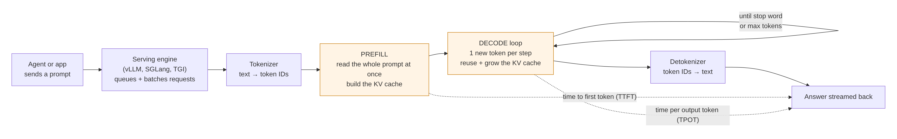

1. The app or agent sends a prompt to a **serving engine** (vLLM, SGLang, TGI…).
2. The engine **queues** it and puts it in a **batch** with other users' requests.
3. The **tokenizer** turns text into token IDs.
4. **Prefill:** the model reads the whole prompt at once and stores what it learned about each
   token in the **KV cache**.
5. **Decode:** the model makes one new token per step, reusing and growing the KV cache, until a
   stop token or the length limit.
6. Tokens are turned back into text and **streamed** to the user.

### 2.3 Prefill vs decode: the single most important idea

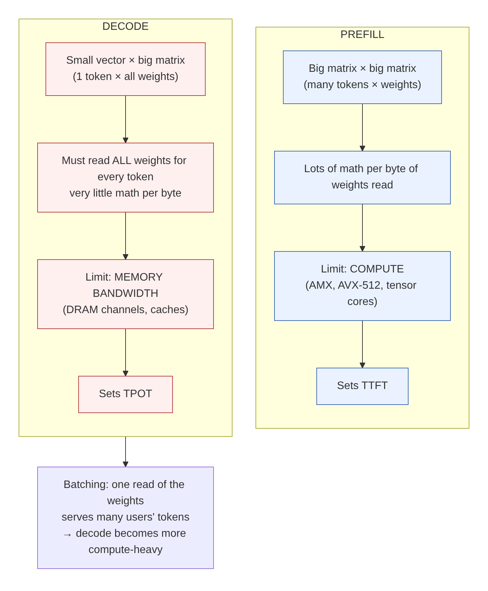

| | Prefill | Decode |
|---|---|---|
| What happens | All prompt tokens processed together | One new token per step |
| Math shape | Matrix × matrix | Vector × matrix (for one user) |
| Work per byte of weights read | High | Very low |
| Usually limited by | **Compute** (AMX, AVX-512) | **Memory bandwidth** (DRAM) |
| User feels it as | **TTFT**, time to first token | **TPOT**, time per output token |

**Why decode is memory-bound, with arithmetic.** For every new token, the CPU must stream *all*
the weights from memory, but does only about 2 operations per weight.

*Arithmetic:* a Xeon socket with 8 channels of DDR5-4800 has a **theoretical peak** of
4800 million transfers/s × 8 bytes × 8 channels ≈ **307 GB/s**. If a 1.5B model needs ~3 GB read
per token, then for **one user**:

```
max tokens/s  ≈  memory bandwidth / bytes read per token  ≈  307 GB/s / 3 GB  ≈  100 tokens/s
```

For an 8B model (~16 GB): about 19 tokens/s. Real numbers are lower (you never reach peak
bandwidth). **This one formula explains most of LLM decode performance.**

> "Decode reads every weight once per token and does almost no math per byte, so it's bandwidth-
> bound. The fixes all reduce bytes per useful token: batching shares one read across many users,
> quantization makes each weight smaller, and speculative decoding verifies several tokens per read."

### 2.4 The KV cache

**One sentence:** for every token already seen, the model keeps two vectors per layer (a **key**
and a **value**) so it never recomputes them; that store is the KV cache, and it grows with every
token.

**Size formula:**

```
KV bytes per token = layers × KV heads × head size × 2 (key and value) × bytes per number
```

| Model | Calculation | Per token (*arithmetic*) |
|---|---|---|
| Qwen2.5-1.5B, BF16 | 28 × 2 × 128 × 2 × 2 | **28 KiB** |
| Llama-3-8B class, BF16 | 32 × 8 × 128 × 2 × 2 | **128 KiB** |

**Why it matters:** the KV cache, not the weights, often decides **how many users fit at once**.
In this project: 32 users × 4,096 tokens × 28 KiB = **3.5 GiB**, so you set the vLLM CPU cache to
4 GiB on a 16 GiB machine (§4.3). A first draft said 8 GiB; the arithmetic showed that was
wasteful and risky.

**KV cache also costs bandwidth:** in decode the model reads the whole KV cache of each user every
step, so long conversations make decode slower. That is why KV-cache quantization (storing it in
FP8 or INT8) exists.

### 2.5 PagedAttention

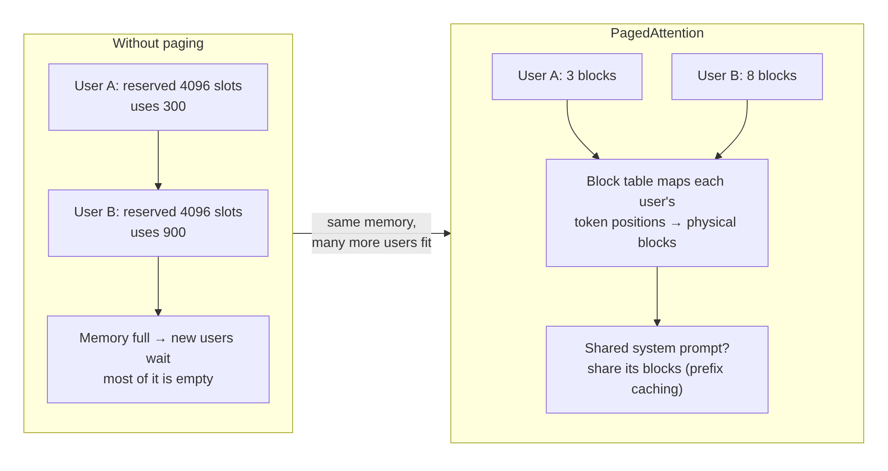

**One sentence:** store the KV cache in small fixed-size blocks with a lookup table, exactly like
an operating system's virtual-memory pages, so a user takes only the memory they actually use.

- **Before:** each request reserved space for its maximum length; most of it sat empty; fewer
  users fit.
- **After (vLLM):** blocks are handed out as tokens are produced. A **block table** maps each
  user's positions to physical blocks. More users fit in the same memory.
- **Bonus, prefix caching:** if many requests start with the same system prompt (very common in
  **agents**), they can share those blocks. SGLang's **RadixAttention** pushes this further with a
  tree of shared prefixes.

> "PagedAttention is virtual memory for the KV cache. It removes fragmentation so more sequences fit,
> and it makes prefix sharing cheap, which matters a lot for agents that resend the same long system
> prompt on every call."

### 2.6 Continuous batching

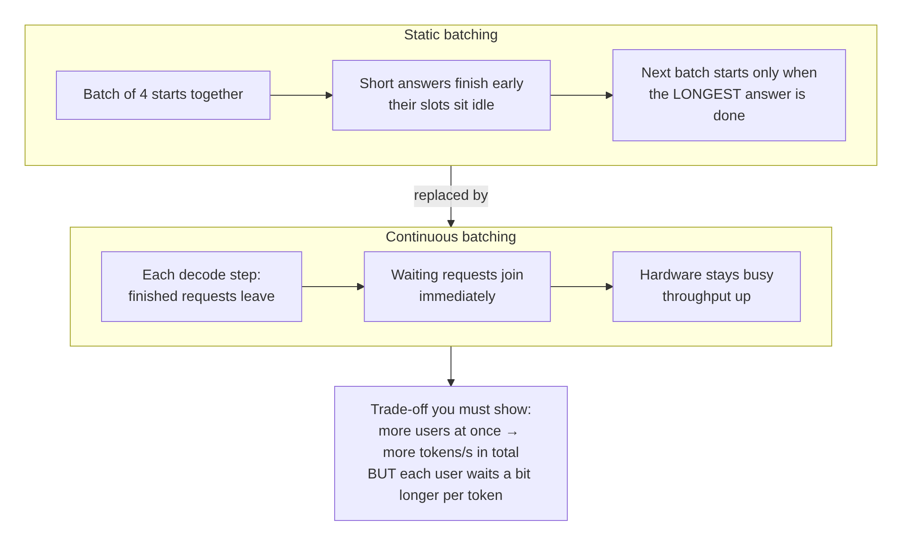

- **Static batching:** a group starts together and the next group waits for the **longest** answer.
  Short answers leave hardware idle.
- **Continuous batching:** at **every decode step** finished requests leave and waiting ones join.
  The hardware stays busy.
- **The trade-off you must always show:** more concurrent users → more total tokens/s, but each
  user's tokens come a bit slower. You measured exactly this (§4.3, finding 1).
- **Chunked prefill:** a long prompt is split into pieces so it does not stall everyone else's
  decode steps. vLLM turns it on by default (the rehearsal log shows `enable_chunked_prefill=True`).

### 2.7 Quantization

**One sentence:** store weights (and sometimes activations or the KV cache) in fewer bits, so each
token needs fewer bytes read and less memory; the cost is some accuracy risk.

| Format | Bits | Typical use | On Intel Xeon |
|---|---|---|---|
| FP32 | 32 | Training reference | Slow for inference |
| **BF16** | 16 | Default for inference | **AMX** (4th Gen Xeon onwards), AVX-512 BF16 |
| FP16 | 16 | Common on GPUs | AMX-FP16 on Xeon 6 (Granite Rapids) |
| FP8 | 8 | GPUs, Gaudi; KV cache | Mostly a GPU/accelerator format today |
| **INT8** | 8 | Weights and activations | **AMX-INT8**, AVX-512 **VNNI** |
| **INT4** | 4 | Weights only | Usually unpacked to BF16 inside the kernel ("weight-only") |

Key ideas:

- **Weight-only quantization** (e.g. INT4 weights, BF16 math) mainly helps **decode**, because
  decode is about bytes read.
- **Weight + activation quantization** (e.g. INT8 × INT8) also helps **prefill**, because the math
  itself gets faster on AMX-INT8 / VNNI.
- Always measure **accuracy next to speed**. In this project every backend runs the same 65-example
  accuracy test (§4.2).
- llama.cpp's **GGUF** formats: Q8_0 (~8 bits), Q4_K_M and Q4_0 (~4 bits). You converted the same
  weights into all of them yourself.

> "Quantization is compression for weights. Like zstd in Cassandra, it trades a little compute to
> move fewer bytes. In decode, fewer bytes is the whole game."

### 2.8 Attention, in one paragraph

Attention lets each new token look back at all previous tokens: it compares the new token's
**query** with every stored **key**, turns the scores into weights, and mixes the stored **values**.
For decode this is mostly reading the KV cache, so it is **memory-bound**. **FlashAttention**-style
kernels compute attention in tiles that fit in cache, never writing the big score matrix to memory;
the idea is the same as cache-blocking a matrix multiply.

### 2.9 Other tricks you should be able to name

| Technique | Idea in one line | Helps |
|---|---|---|
| **Speculative decoding** | A small "draft" model guesses several tokens; the big model checks them in one pass | Decode (more tokens per weight read) |
| **Prefix caching** | Reuse KV cache for a shared prompt start | TTFT for agents and chats |
| **Tensor / pipeline parallelism** | Split a model across sockets, GPUs or nodes | Models too big for one device |
| **Disaggregated prefill/decode** | Run prefill and decode on different machines | Different bottlenecks, tuned separately |
| **Structured / constrained output** | The engine only allows valid tokens (e.g. a JSON schema or a fixed list) | Correctness; you used it (§4.3) |

### 2.10 The KPIs: what to measure

| KPI | Meaning | Why it matters |
|---|---|---|
| **TTFT** | Time to first token | Responsiveness; driven by prefill and queueing |
| **TPOT** (also ITL, inter-token latency) | Time between tokens after the first | Streaming speed; driven by decode |
| **E2E latency p50 / p95 / p99** | Whole request time, as a distribution | Averages hide the slow tail users feel |
| **Output tokens/s** | Total generation throughput | Capacity |
| **Requests/s** | Completed requests per second | Capacity in user terms |
| **Saturation point** | Concurrency where tokens/s stops rising | Beyond it you only add latency |
| **Goodput** | Requests/s that still meet the latency target | The honest capacity number |
| **Cost per 1M output tokens at a latency target** | Price per hour ÷ tokens per hour at an acceptable p95 | The business decision |
| **Accuracy** | Right answers on a fixed test | A fast wrong model loses |
| System KPIs | CPU %, IPC, memory bandwidth GB/s, LLC misses, top-down buckets, AMX use | The **why** behind the numbers above |

*Cost formula (illustrative values):* at $0.40/hour and 200 tokens/s,
cost = 0.40 / (3600 × 200) × 1,000,000 ≈ **$0.56 per million output tokens**.

### 2.11 Serving engines you should know

| Engine | One line | When it shines |
|---|---|---|
| **vLLM** | PagedAttention + continuous batching; OpenAI-compatible API; CPU, GPU and more | General serving; the reference engine |
| **SGLang** | RadixAttention prefix sharing, fast structured output | **Agentic** workloads with many calls sharing prompts |
| **TGI** | Hugging Face's server; now largely in maintenance | Existing HF deployments |
| **OpenVINO** (and OpenVINO Model Server) | Intel's toolkit, tuned for Intel CPUs, GPUs and NPUs | Intel hardware, especially edge and CPU |
| **llama.cpp** | Small C/C++ engine, many quantized GGUF formats, CPU-first | Local and CPU inference; Arm KleidiAI and x86 AVX-512 kernels |

### 2.12 Why agents change the performance picture

You know agents; here is the performance view:

- **Many calls per task:** one agent run makes many LLM calls; total latency is the sum, so
  **TTFT** matters more than for a chatbot.
- **Long shared prompts:** system prompt + tool definitions are resent every call → **prefix
  caching** saves most of the prefill.
- **Small, frequent steps** (classify, route, extract) can go to a **small model on CPU**; that is
  the question your inference lab asks.
- **Tool time** (APIs, databases) sits between LLM calls; measure it separately or you blame the
  model for waiting on a tool.

### 2.13 How CPU inference works, end to end

**One sentence:** CPU inference runs the whole model on the server's normal processor: the weights
live in ordinary RAM and the CPU cores do all the math, with no GPU.

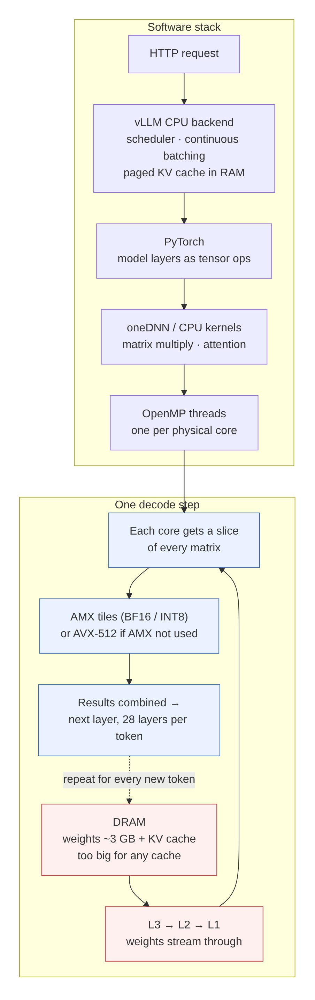

#### The layers, top to bottom

| Layer | Its job on a CPU |
|---|---|
| **vLLM (CPU backend)** | Takes requests, does continuous batching, keeps the paged KV cache in RAM (size set by `VLLM_CPU_KVCACHE_SPACE`) |
| **PyTorch** | Runs the model's layers as tensor operations |
| **oneDNN / CPU kernels** | Do the heavy work (matrix multiply, attention) with the best instructions the CPU has |
| **OpenMP threads** | One thread per core; each thread takes a slice of every matrix |
| **Cores** | **AMX** (matrix unit) when data is BF16 or INT8 and the kernel supports it; otherwise **AVX-512** |
| **Caches → DRAM** | Weights and KV cache stream from memory for every token |

The model and the API are the same as on a GPU. Only the bottom layers change.

#### What happens for one new token

The model is a stack of layers (28 for Qwen2.5-1.5B). For each new token, each layer does a few
matrix multiplications:

1. The matrix is **split across the cores**: each OpenMP thread gets a slice.
2. Each core **streams its slice of the weights** from DRAM through L3, L2 and L1.
3. The core multiplies with **AMX** tiles or **AVX-512** vectors.
4. The slices are combined; the next layer starts. After the last layer, one token is chosen.

**The key fact:** the weights (~3 GB for this model) are far bigger than the CPU's caches (tens to a
few hundred MB), so **they come from DRAM again for every token**. That is why memory bandwidth
decides decode speed on a CPU.

#### Prefill and decode on a CPU

| | Prefill (the prompt) | Decode (each new token) |
|---|---|---|
| Work | Many tokens at once: matrix × matrix | One token per user: vector × matrix |
| Limited by | Compute | Memory bandwidth |
| Xeon feature that helps | **AMX**, a matrix-multiply unit in every core; Intel's published figures: 1,024 BF16 or 2,048 INT8 operations per cycle per core | More memory channels, fewer bytes (quantization), more users per weight read (batching) |
| User feels it as | TTFT | TPOT |

**Batching is how a CPU catches up.** With 8 users decoding together, each weight read is used 8
times, so decode turns back into matrix × matrix and AMX gets real work. That is why your
rehearsal saw throughput rise 4.35× at 8 users (§4.3).

#### Why choose a CPU at all

| Strength | Why it matters |
|---|---|
| **Memory size** | Hundreds of GB of RAM: big KV caches, many users, large models fit |
| **Already there** | Every data centre has Xeons; no GPU queue or special drivers |
| **No copies** | Data stays in RAM; nothing moves to GPU memory |
| **Cost for small models** | A 1–8B model at modest volume can cost less per token on CPU |
| **Mixed work** | The same server runs the app, the database calls and the model |

**Limits:** a GPU has far more compute and usually more memory bandwidth than a CPU instance gets, so
large models, long prompts and high volume favour GPUs. The honest answer is always: "it depends on
model size, batch and latency target, so measure cost per token at the latency target."

#### What makes CPU numbers good or bad

| Knob | Why | In your project |
|---|---|---|
| **Threads = physical cores** | Extra threads fight for bandwidth | vLLM used 3 of 4 CPUs; it keeps one for its own scheduler |
| **Pinning (affinity)** | Threads that move between cores lose their cache | `VLLM_CPU_OMP_THREADS_BIND` recorded |
| **NUMA locality** | Memory on the other socket is slower (it travels over UPI) | vLLM logged a NUMA memory-bind to node 0 |
| **Hyper-threading** | The second thread often adds little in decode | Why you compare per physical core |
| **dtype BF16 or INT8** | Lets AMX run; FP32 does not | BF16 everywhere |
| **Check AMX is really used** | A wrong build or dtype silently falls back to AVX-512 | `ONEDNN_VERBOSE=1`, look for `amx` (next step) |
| **KV cache size** | Too small → users wait; default → too much RAM | Default wanted ~13–14 GiB; sized to 4 GiB from the formula |
| **Shared memory** | vLLM's processes share data through `/dev/shm` | 160 MiB needed vs Docker's 64 MiB |
| **Huge pages, allocator** | Fewer TLB misses; less `malloc` overhead | On the BKC list (§3.4) |
| **Quantization** | Fewer bytes per token → faster decode | llama.cpp Q8_0 / Q4 formats |

#### How to say it

> "On CPU, the weights sit in DRAM and every decode step streams them through the caches, so
> single-user decode is limited by memory bandwidth per socket. Prefill and batched decode are
> matrix-heavy, and that's where AMX earns its keep. So the CPU playbook is: keep memory local with
> NUMA binding and threads pinned to physical cores, make sure AMX is actually used with BF16 or
> INT8, batch enough users to turn decode into matrix work, quantize to cut bytes per token, and
> judge it all by cost per token at the latency target. Top-down tells me which one is the
> bottleneck: Memory Bound means bytes; Core Bound or low Retiring means the kernels."

---

## 3. Finding the "why": server hardware, Linux and the tools

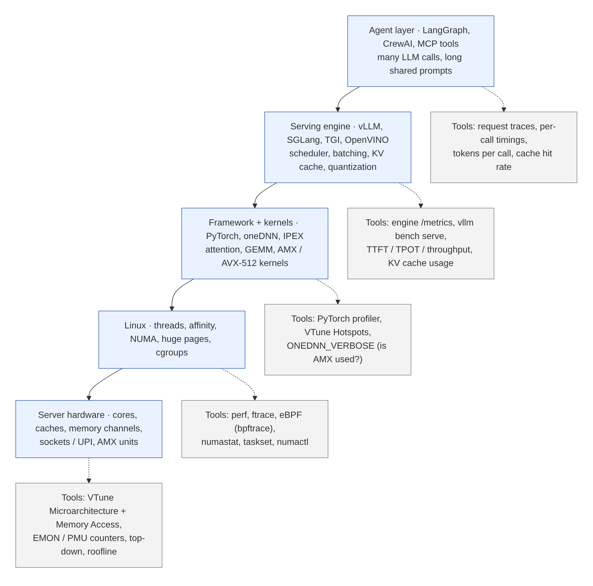

### 3.1 The Xeon server in five minutes

| Part | What to know | Why it matters for LLMs |
|---|---|---|
| **Cores and SMT** | Each core can run 2 hardware threads (Hyper-Threading) sharing its units | For bandwidth-bound decode, the 2nd thread often adds little; on cloud, an x86 "vCPU" is usually a hyperthread |
| **Caches** L1 / L2 / LLC (L3) | Small and fast near the core, bigger and slower further out | Weights (GBs) never fit; they stream from DRAM every token |
| **Memory channels** | Each socket has several DDR5 channels | Total bandwidth = the decode speed limit |
| **NUMA** | Each socket (or sub-socket with **SNC**, sub-NUMA clustering) has its own memory; remote memory is slower | Threads on socket 0 reading memory on socket 1 lose bandwidth and add latency |
| **UPI** | The link between sockets | Cross-socket traffic shows up here |
| **AVX-512** | 512-bit vector instructions; **VNNI** for INT8 dot products; **AVX512_BF16** | Fast vector math |
| **AMX** (4th Gen Xeon and later) | Tile registers + a matrix-multiply unit (TMUL) for **BF16 and INT8**; FP16 on Xeon 6 | Big speedups for matrix-matrix work: **prefill** and **batched decode** |

**Real detail from this project:** the machine the rehearsal ran on reported CPU family 6
model 207 (a **5th Gen Xeon**) with flags `amx_bf16 amx_int8 amx_tile avx512_bf16 avx512_vnni
avx512f`, and vLLM's log said it applied a **NUMA memory-bind policy** to node 0.

> "On Xeon I'd expect prefill and batched work to benefit from AMX, and single-user decode to be
> limited by DRAM bandwidth per socket. So the first BKC questions are: is AMX actually used, is
> memory local to the threads, and is the batch big enough to make decode compute-heavy?"

### 3.2 Top-down analysis (TMA)

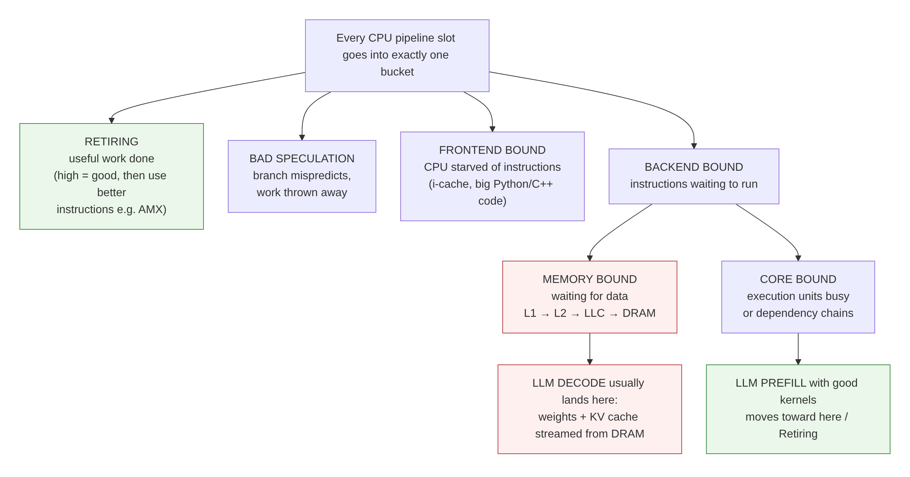

**One sentence:** every slot in the CPU pipeline ends up in exactly one of four buckets, and the
biggest bucket tells you where to look next.

| Bucket | Meaning | LLM example | Typical fix |
|---|---|---|---|
| **Retiring** | Useful work | Prefill on good AMX kernels | Use better instructions (AMX), fewer instructions |
| **Bad speculation** | Wrong branch guesses, work thrown away | Branchy Python or scheduler code | Simpler control flow |
| **Frontend bound** | CPU starved of instructions | Huge Python/C++ code paths, JIT code | Code layout, fewer layers per token |
| **Backend bound → Memory bound** | Waiting for data from L2/LLC/DRAM | **Decode**: streaming weights and KV cache | Batching, quantization, NUMA locality, huge pages |
| **Backend bound → Core bound** | Execution units busy or long dependency chains | Non-AMX matrix math | Vector/matrix units, better kernels |

Commands: `perf stat -M TopdownL1 -- <cmd>` (newer perf), `toplev` from pmu-tools, or VTune
**Microarchitecture Exploration**. Go level by level: L1 → the biggest bucket → its children.

### 3.3 The roofline model

**One sentence:** a chart that tells you whether a kernel is limited by memory or by compute, from
one number, its **arithmetic intensity** (operations per byte moved).

```
 attainable
 performance                         ______________________  ← compute roof (peak FLOP/s, e.g. AMX)
 (FLOP/s)                          /
                                 /
                               /   ← memory roof: slope = memory bandwidth
                             /
                           /
          decode (batch 1) ●            ● prefill / big batches
          low ops per byte             high ops per byte
          → under the memory roof      → near the compute roof
     ──────────────────────────────────────────────────────────►
                     arithmetic intensity (FLOP per byte)

  attainable = min( peak compute ,  bandwidth × arithmetic intensity )
```

- **Decode at batch 1** sits far left: under the slanted memory roof. More compute does not help;
  fewer bytes or more reuse does.
- **Batching** moves decode **to the right** (each weight byte is used for many users).
- **Quantization** also moves it right (fewer bytes for the same math).
- Tool: **Intel Advisor** draws rooflines from measured kernels; VTune shows memory bandwidth.

### 3.4 Linux knobs that change LLM numbers

| Knob | What it does | Check or set with |
|---|---|---|
| **Thread count** | Too many threads fight for bandwidth and cores | `OMP_NUM_THREADS`; vLLM `VLLM_CPU_OMP_THREADS_BIND` |
| **Affinity / pinning** | Keep threads on chosen cores | `taskset`, `numactl --physcpubind`, `KMP_AFFINITY` / `OMP_PROC_BIND` |
| **NUMA locality** | Keep memory on the same socket as the threads | `numactl --cpunodebind=0 --membind=0`, `numastat` |
| **One instance per socket (or per SNC domain)** | Avoids cross-socket traffic | Run N servers, put a router in front |
| **Huge pages** | Fewer TLB misses on GB-sized weight buffers | `/sys/kernel/mm/transparent_hugepage/enabled` |
| **Memory allocator** | Less allocator overhead and fragmentation | `LD_PRELOAD` tcmalloc or jemalloc |
| **cgroups / cpusets** | Containers and Kubernetes limit CPUs and memory | Kubernetes static CPU manager gives exclusive cores |
| **Shared memory size** | Multi-process engines share tensors through `/dev/shm` | Docker `--shm-size` or `--ipc host` (you hit this, §4.3) |
| **CPU frequency** | Turbo and power policy change results | `cpupower`, record it with every run |

### 3.5 Which tool answers which question

| Question | Tool | Example |
|---|---|---|
| Where does the time go (functions)? | `perf record` + flame graph, VTune **Hotspots** | `perf record -g -p <pid>; perf report` |
| Is the CPU stalled on memory or busy? | Top-down: `perf stat -M TopdownL1`, VTune **Microarchitecture Exploration**, toplev | Decode → Memory bound |
| How much DRAM bandwidth am I using? | VTune **Memory Access**, Intel **PCM** (`pcm-memory`), Intel **MLC** for the machine's ceiling | Compare used vs available |
| Raw counters across the whole system | **EMON** (Intel's PMU collector), `perf stat -e <events>` | LLC misses, UPI traffic |
| Is AMX actually used? | `ONEDNN_VERBOSE=1` shows the kernel ISA (look for `amx`) | If it says `avx512` only, AMX is not used |
| Is it compute- or memory-limited (kernel)? | **Intel Advisor** roofline | Place the kernel on the chart |
| What is the OS doing (scheduling, syscalls, page faults)? | **ftrace**, **eBPF** (`bpftrace`, bcc tools like `runqlat`, `offcputime`) | Threads waiting in the run queue |
| What is the engine doing? | vLLM `/metrics` (Prometheus), `vllm bench serve` | Running vs waiting requests, KV cache usage |
| Is the Python layer the problem? | PyTorch profiler, `py-spy` | Scheduler overhead per step |

**A real caution from this project:** in a virtual machine, hardware counters may not be exposed
at all. The rehearsal VM's kernel said: *"no PMU driver, software events only."* Counter-level work
needs bare metal or an instance that exposes the PMU. Saying this shows you have done it for real.

### 3.6 The method: how you go from "what" to "why"

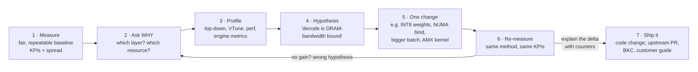

1. **Measure** a fair baseline: same model, dtype, prompt, threads; warm-up thrown away; at least
   3 runs; median and spread.
2. **Ask which layer:** engine (queueing? cache full?), framework (which kernel?), OS (threads,
   NUMA), hardware (top-down bucket).
3. **Profile** with the tool for that layer.
4. **Write one hypothesis:** "decode is DRAM-bandwidth-bound because …".
5. **Change one thing.**
6. **Re-measure** the same way. If no gain, the hypothesis was wrong; go back.
7. **Ship it:** code change, upstream PR, BKC, or customer guide.

### 3.7 A worked debugging story (practice saying this)

**Problem:** "vLLM on a 2-socket Xeon gives fewer tokens/s than expected."

| Step | Check | What you would see if it's the cause | Fix |
|---|---|---|---|
| 1 | Threads and pinning | More threads than cores, or threads spread over both sockets | Pin to one socket's physical cores; vLLM reserves one core for its own process (seen in §4.3) |
| 2 | NUMA | `numastat` shows remote memory; UPI traffic high | `numactl --membind`, one instance per socket |
| 3 | AMX in use? | `ONEDNN_VERBOSE` shows `avx512` kernels, not `amx` | BF16 weights, a build or flag that enables AMX |
| 4 | Batch size | Engine metrics show few running requests | More concurrency, larger `max-num-seqs`, bigger KV cache |
| 5 | KV cache size | Requests waiting while memory is free | Raise `VLLM_CPU_KVCACHE_SPACE` (sized with §2.4's formula) |
| 6 | Top-down | Memory bound high in decode | Quantize weights (INT8/INT4), speculative decoding |
| 7 | Huge pages, allocator | High dTLB misses, allocator in hotspots | THP on, tcmalloc/jemalloc |

---

## 4. Your proof: what you built and what it shows

### 4.1 The inference lab in plain words

**One sentence:** a lab that answers "which hardware and serving runtime should run my agent's
cheap, high-volume classification step, at what latency, throughput, cost and accuracy?"

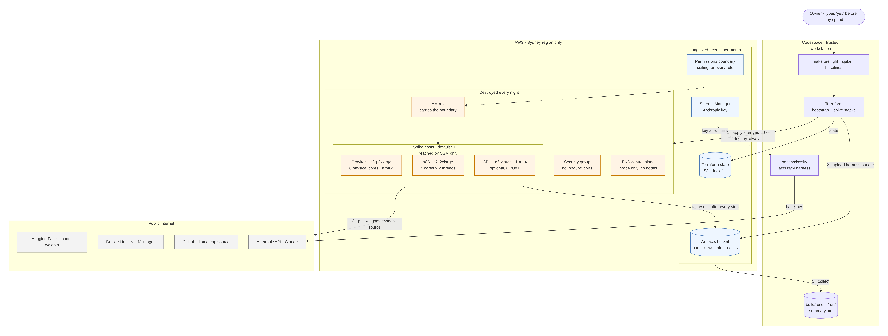

- **The workload is real:** the first step of your triage agent sorts a failed job into one of four
  classes. Today rules do it (54 of 65 right on the shared test set).
- **The candidates:** a small open model (Qwen2.5-1.5B-Instruct) served by **vLLM** and by
  **llama.cpp**, on an Arm Graviton host, an **Intel Xeon (c7i)** host, and optionally an NVIDIA GPU.
- **The method first:** same model revision and BF16 everywhere; thread settings recorded; warm-up
  dropped; ≥ 3 repetitions; results per instance, per dollar and per physical core; accuracy next
  to speed.
- **Engineering:** one command runs everything, shows the cost, waits for "yes", collects one
  summary and always destroys the machines. Tested in five layers before spending money (§4.6).

**How to describe it for an Intel panel:**

> "It's a characterization harness. The question compares Arm and x86 at equal cost, but the value
> for this role is the method: same model and dtype, recorded threads and binding, warm-up,
> repetitions, accuracy next to speed, and every finding explained. On the Xeon side it records the
> CPU flags, so it shows whether AMX and AVX-512 BF16 are available, and the next step is counter-
> level analysis of prefill and decode."

### 4.2 Measured result: the accuracy baseline

*Measured* (raw predictions in `results/baselines-20261111/`): the rule classifier gets
**54/65 = 0.83**, macro-F1 **0.81**.

| Class | Precision | Recall |
|---|---|---|
| user_input_error | 1.00 | 1.00 |
| cloud_outage | 0.84 | 0.89 |
| unsupported_transformation | 1.00 | **0.60** |
| unknown | 0.53 | 0.75 |

**Why it matters:** the 11 misses are exactly where a model must earn its place. Speed without this
table is meaningless.

### 4.3 Real findings, each with its WHY

All from real runs of the actual host script on a **4-vCPU 5th Gen Xeon VM with AMX**, vLLM 0.33
CPU image, BF16. The model was a **tiny test model** (real Qwen2 tokenizer, random weights) because
the lab environment could not download the real one. So the *absolute* numbers say nothing about
Qwen2.5-1.5B; the **behaviours and their causes** are real.

**Finding 1: batching raised throughput 4.35×, not 8×.** *Measured*, `vllm bench serve`, 48
requests, 512-token prompts, 64-token answers, single run:

| Concurrency | Requests/s | Output tokens/s | TTFT median | TPOT median |
|---|---|---|---|---|
| 1 | 3.13 | 200 | 17.5 ms | 4.67 ms |
| 8 | 13.60 | 870 | 49.1 ms | 8.49 ms |
| **Change** | **×4.35** | **×4.35** | **×2.8** | **×1.8** |

**Why:**
1. Continuous batching shares each weight read across 8 users, so total throughput rises.
2. Each step now does 8 users' work, so each user's tokens come slower (TPOT ×1.8) and prompts
   wait their turn (TTFT ×2.8). That is the batching trade-off from §2.6, measured.
3. Not 8×, because: vLLM kept 1 of the 4 CPUs for itself (Finding 2), so only 3 did the math; the
   benchmark client ran on the **same 4 CPUs** and competed with the server; and with a tiny model,
   fixed per-step costs (Python scheduler, tokenizing, HTTP) are a large share.

> "That's why the real benchmark puts the load generator on its own node, and why I'd look at
> top-down and the engine's scheduler time before calling it a hardware limit."

**Finding 2: vLLM's CPU backend reserves a core.** *Measured* from vLLM's own log on 4 CPUs:
`OMP_NUM_THREADS=3`. **Why:** vLLM keeps one CPU for its front-end and scheduler process so the
compute threads are not interrupted. **Consequence:** on an 8-vCPU machine only 7 do the math.
This must be in any per-core comparison, and on x86 those 8 vCPUs are only 4 physical cores.

**Finding 3: run-to-run noise is real.** *Measured:* two runs of the same benchmark on the same
machine gave **15.96** and **13.60** requests/s at concurrency 8 (about a 15% difference); at
concurrency 1, 3.05 and 3.13 (about 3%). **Why:** higher concurrency is more sensitive to
scheduling and neighbours on a shared VM. **Lesson:** ≥ 3 repetitions, report median and spread,
never one number.

**Finding 4: the default KV cache wanted almost all memory.** *Measured:* with no cache setting,
vLLM CPU asked for about **13–14 GiB** of KV cache on a 15.7 GiB machine (log: "available memory on
node 0 (12.71/15.71 GiB) … less than requested memory for kv (13.32/14.45 GiB)") and refused to
start. **Why:** the CPU backend sizes the cache from available memory
unless you set `VLLM_CPU_KVCACHE_SPACE`. **Fix:** size it from the formula (§2.4) — 4 GiB is enough
for 32 users × 4,096 tokens. Note it checks memory **per NUMA node**.

**Finding 5: shared memory too small.** *Measured:* vLLM needed **160 MiB** of `/dev/shm` and
Docker's default is **64 MiB**; it failed to start. **Why:** vLLM's processes pass data through
shared memory. **Fix:** `--shm-size` on CPU, `--ipc host` on GPU. (A Linux and container lesson.)

**Finding 6: open-file limits.** *Measured:* vLLM warned it could not raise the open-file limit
(20,000), and forcing 65,536 broke container startup because the Docker daemon's own hard limit
was lower. **Fix:** use the lower of the two. (cgroups and limits in practice.)

**Finding 7: constrained output fixes format, not knowledge.** *Measured:* with output restricted
to the four class names, **0 of 65** answers were invalid; in free text the same random model gave
65 invalid answers. **Why:** the engine masks every token that would not form a valid class name.
**Lesson:** report "constrained" and "free text" separately, so you know whether the model is wrong
or just badly formatted.

**Finding 8: no hardware counters in the VM.** *Measured:* the kernel said "no PMU driver,
software events only." **Lesson:** counter-level analysis (top-down, EMON) needs bare metal or an
instance that exposes the PMU; plan for it.

**Finding 9: the KV cache barely compresses, and the reason is the number format.** *Measured* on
the **real Qwen2.5-1.5B-Instruct** (65 classification requests plus one agent transcript, BF16 KV
cache, single run): 28 KiB of KV cache per token. Best lossless result: zstd on split byte planes,
**1.44×** (31% smaller). Raw BF16 with zstd: 1.26×. **LZ4: 1.00×**, no gain at all. **Why:** each
BF16 number has a predictable exponent byte (2.96 bits of entropy) and a near-random mantissa byte
(7.97 bits), so the ceiling is about 1.46×, and the gain comes only from entropy coding, which LZ4
doesn't do. **Lesson:** quantize the KV cache to 8 bits first (2×), then compress losslessly only
where bytes are expensive: SSD, remote caches, transfers between nodes. Files:
`experiments/kv-compression/`, `results/kv-compression-20261117/`.

**What is not measured yet (say so):** the real Graviton vs Xeon comparison with Qwen2.5-1.5B, the
llama.cpp KleidiAI A/B, the GPU reference, and counter-level analysis. Those run on AWS next.

### 4.4 The agentic system: pipeline-triage-agent

**One sentence:** an AI agent that triages failed data-ingestion jobs and proposes fixes as pull
requests a human must approve.

| Part | What you built | Performance angle |
|---|---|---|
| Rules first | Deterministic classifier before any model call | Cost scales with new failures, not volume |
| Bounded agent loop | One model turn per AWS Step Functions state; step, token and time budgets | Crash loses one step; cost bounded per run |
| Tools over **MCP** | Six read-only tools served by an MCP server | Same tools for the agent and for engineers |
| Hybrid retrieval | BM25 + embeddings fused | Measured with recall@k |
| Four validation gates | Schema, patch, grounding, verifier | Correctness before speed |
| Eval suite | 8 end-to-end scenarios graded automatically | Change models only on evidence |
| Prompt caching | On the multi-step loop, off for one-shot calls | A cache write costs more than it saves on a one-shot call |

**Link to this job:** the inference lab exists **because** of this agent: it asks whether the
agent's cheap step can move to a small model on a CPU. That is Intel's "Agentic AI workloads on
Intel platforms" in one sentence.

### 4.5 Your earlier career, mapped to this job

| What you did | JD line it proves |
|---|---|
| Architected Intel's Workload Services Framework, the benchmark orchestrator for Xeon validation (Sapphire Rapids, Granite Rapids); sign-off from a quarter to ~2 weeks | Workload characterization on server platforms; reusable, trusted measurement |
| JVM tuning, lock contention, perf, VTune, flame graphs | Find bottlenecks across runtime, OS and hardware; profiling tools |
| QAT Java library, **23% throughput gain** (your resume) | Hardware-aware optimization; accelerator offload; measured gain |
| Lucene and OpenSearch zstd codec work | Software optimization of a data path; codec trade-offs (ratio vs CPU) |
| Cassandra compaction with zstd and QAT, measured with NoSQLBench | The full loop: bottleneck → change → measure → explain (§6) |
| Goldman Sachs (via Rearc): AWS lakehouse ingestion, Claude agent layer | Production agentic AI |
| inference-lab, pipeline-triage-agent | LLM serving, KV cache, batching, quantization, agents |

### 4.6 How you checked your own work (engineering rigour)

Five test layers, cheapest first, before any cloud spend: static checks; unit tests against fake
servers; the real deploy scripts against an AWS emulator (49 checks); the real host script run on a
Xeon VM with vLLM and llama.cpp (44 checks CPU, 35 checks GPU path); then the real cloud run. They
caught bugs that would have lost every result or wasted paid time (for example an invalid AWS CLI
flag, and a health check that waited 20 minutes on a crashed container). Good to mention when they
ask how you make benchmark infrastructure trustworthy.

---

## 5. The product: Intel Agent Toolkit, and where your work fits

The job sits in Intel's "AI Solutions and **Toolkit** Engineering" team. Intel's open-source
**Agent Toolkit** (`intel/enterprise-agent-toolkit`) is very likely the product that team builds,
so this section teaches it in their own words and shows where your work adds value.

Source: your study fork, `praveennish/agent-toolkit`, branch `claude/inspiring-hawking-lzeaaz`,
folder `doc/` (design, 12 ADRs, a code walkthrough and a long Q&A pack). Everything below comes
from that repository's docs. Say **"I studied it"** in the interview; you did not build it.

### 5.1 What it is, in one minute

**One sentence:** a Kubernetes platform that installs everything an AI agent needs in production
*except the agent itself*, and runs it on Xeon.

Their core idea, from the README: *"GPUs accelerate reasoning. But the value of agentic AI comes
from end-to-end task execution, and that control plane (state, tools, policy, coordination) runs
efficiently on CPUs."*

| Block | Default it ships with |
|---|---|
| API gateway and access | LiteLLM (virtual keys, budgets, rate limits) behind Envoy Gateway (TLS) |
| Inference routing | Hybrid Router: a rules classifier plus a bandit per tier |
| Model serving | vLLM on Xeon under KServe; OpenVINO Model Server on the Docker path |
| Safety | A fail-closed guardrail using Qwen3Guard-Gen-0.6B |
| Memory | Redis Stack (session state) and PostgreSQL 16 + pgvector (long-term memory) |
| Code execution | Agent Sandbox with warm pools; optional Kata microVMs and NVIDIA OpenShell |
| Observability | Langfuse traces, Prometheus, Grafana, Loki |
| Deployment | Ansible roles, Helm charts, Docker Compose for development |

The default chat model is **Qwen2.5-Coder-14B-Instruct**, served by vLLM on CPU. The default
install needs about **131 GiB** of memory.

### 5.2 One request through the stack

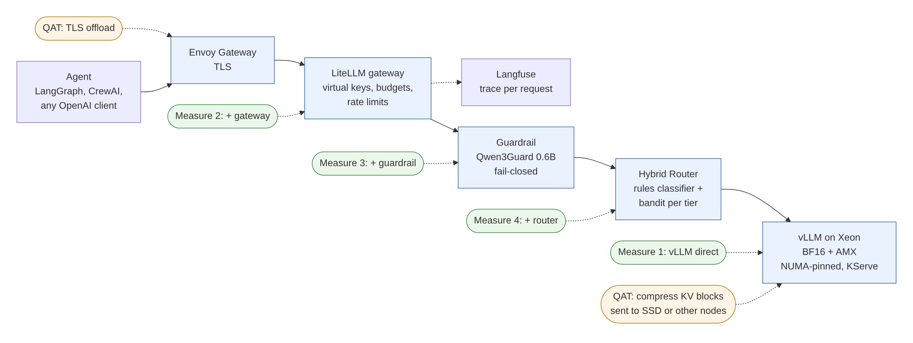

1. The agent calls an OpenAI-compatible endpoint. **Envoy** terminates TLS.
2. **LiteLLM** checks the agent's virtual key, budget and rate limit.
3. The **guardrail** asks a small safety model whether the prompt is safe. If the guard is down,
   the request is blocked (fail-closed).
4. The **Hybrid Router** scores the prompt's difficulty and picks a model for that tier.
5. **vLLM on Xeon** generates the answer; **Langfuse** records the trace.

The green boxes are the four measurement points their own docs propose (§5.5). The orange boxes
are where QuickAssist fits (§5.6).

### 5.3 Inference on Xeon: their settings, mapped to what you know

| Toolkit setting | What it does | Where this guide explains it | Your own evidence |
|---|---|---|---|
| `--dtype bfloat16` | BF16 weights so AMX can do the matrix work | §2.7, §2.13 | Your vLLM runs were BF16 |
| `VLLM_CPU_KVCACHE_SPACE` | GiB reserved for the KV cache | §2.4 | You sized 4 GiB from the formula after the default asked for ~13–14 GiB |
| `VLLM_CPU_NUM_OF_RESERVED_CPU` | Cores kept for vLLM's own process | §4.3 finding 2 | **You found this by measurement:** vLLM ran 3 compute threads on 4 CPUs |
| `--block-size 128` | KV cache block size on CPU | §2.5 | Your KV compression test used 16-token blocks; at 128 tokens a block is 3.5 MiB for Qwen2.5-1.5B |
| `--enable-prefix-caching`, chunked prefill | Reuse shared prompt starts; mix long prompts with decoding | §2.5, §2.6 | — |
| NRI balloons, `cpu: auto`, one NUMA node per tensor-parallel rank | Pins a model's threads and memory to one NUMA node | §3.1, §3.4 | vLLM logged a NUMA memory-bind in your rehearsal |
| Preflight: CPU governor `performance`, THP not `always` | Linux settings that slow inference | §3.4 | — |
| `-specdec` variants | Speculative decoding with a small draft model | §2.9 | — |
| MoE models (Qwen3-Coder-30B-A3B: 3B active of 30B) | Each token reads only the active experts, so fewer bytes per token | §2.3 | — |
| OVMS int4 / int8 (Docker path) | Quantized weights | §2.7 | Your llama.cpp Q8_0 / Q4 runs |

Their memory sizing follows the same formula as §2.4: footprint ≈ weights + tensor-parallel ranks ×
KV cache space + runtime. For Llama-3.1-8B they reserve 40 GiB of KV cache; at 128 KiB per token
that holds about 327,680 tokens across all users.

> "I recognised the toolkit's CPU settings from my own runs: BF16 for AMX, KV cache sized
> explicitly, one core reserved for vLLM's own process, and pinning to one NUMA node. I'd measured
> the reserved core and the KV default myself before I saw them as knobs in `models.yaml`."

### 5.4 The Hybrid Router, and what your work adds to it

**How it works:**

- A free **rules classifier** scores each prompt (length, keywords, multi-step patterns) into
  SIMPLE, MEDIUM, COMPLEX or REASONING (boundaries 0.15, 0.35, 0.60).
- For each tier, a **multi-armed bandit** (Thompson sampling by default) picks one of that tier's
  candidate models and learns from results.
- Reward = `target_tpt / (target_tpt + time_per_token)`, 0 on failure. Defaults: `target_tpt` =
  1.0 s, `quality_weight` = 0 (speed only).

**It's the same shape as your triage agent:** rules first because they're free and explainable,
a cheaper model for most traffic, a bigger model when needed.

**Two improvements you can speak to with authority:**

1. **The reward barely separates models on CPU.** *Arithmetic, illustrative time-per-token values:*

   | Time per token | Reward with `target_tpt` = 1.0 | Reward with `target_tpt` = 0.05 |
   |---|---|---|
   | 50 ms | 0.952 | 0.500 |
   | 100 ms | 0.909 | 0.333 |

   With the default, a model twice as slow scores almost the same, so the bandit learns slowly.
   Fix: set `target_tpt` from measured time per token on that hardware. Their own design notes
   list this as a weakness.

2. **The reward is speed only.** A fast model that answers wrongly still scores well. Your lab's
   rule, *accuracy next to speed*, is the fix: a labelled evaluation set (like your 65-example
   classification set) feeds `quality_weight`, so the router rewards fast **and** right.

> "The Hybrid Router is the same idea as my triage agent's routing: rules first, small model for
> most traffic. Two things I'd tune: calibrate `target_tpt` to the measured time per token, because
> at 1.0 second every CPU model scores about 0.9 and the bandit can't tell them apart; and add a
> quality signal from an evaluation set, because a fast wrong answer shouldn't win."

### 5.5 The gap you can fill: no published inference numbers

Their docs say plainly that the repository publishes **no measured LLM inference numbers**, and
list it as the first weakness: customers can't size a deployment without measuring it themselves.

Their docs also propose how to produce the report, and it matches your method:

| Their proposed method | What you already have |
|---|---|
| Fix and record the setup: CPU, sockets, NUMA, model, tensor-parallel size, KV cache, vLLM version; preflight clean | Every result in your lab records commit, model revision, image digest, CPU flags, threads, KV size |
| Measure four paths: vLLM direct, + gateway, + guardrail, + router | Your load tool (`vllm bench serve`) and harness can point at any OpenAI-compatible endpoint |
| Sweep concurrency 1, 2, 4 … 32 with fixed input and output lengths, plus a realistic prompt mix | Your planned matrix is the same; your classification prompts are a realistic mix |
| Record TTFT, TPOT, tokens/s, p95/p99, errors, CPU per NUMA node, memory | Your KPI list (§2.10) |
| Find the knee where p95 latency rises sharply | Your primary KPI: throughput at a latency target |
| A repeatable harness | Their notes name **Workload Services Framework** as the kind of harness to use. **You architected it.** |

> "Your docs list missing inference numbers as the first gap. That's the work I'd start with: a
> per-SKU report measured four ways, gateway and guardrail costs separated, with the knee and cost
> per million tokens at the latency target, run from a harness like WSF so it repeats on every
> release."

### 5.6 Where QuickAssist and the KV cache fit in the toolkit

- **TLS at the gateway.** Every agent call crosses Envoy over TLS. On a busy gateway node that is
  CPU work QuickAssist can take over (see the ROI brief).
- **KV cache blocks are big enough to offload.** With `--block-size 128`, one block is 3.5 MiB for
  Qwen2.5-1.5B and 16 MiB for an 8B Llama-class model (128 tokens × 128 KiB). Accelerators work best
  on large buffers.
- **Prefix caching for agents.** Agents resend long system prompts and tool definitions. Keeping
  those KV blocks on SSD and compressing them (up to 1.44× measured on a real model, §4.3 finding 9)
  stores more of them per TB. Quantizing the KV cache to 8 bits comes first; it gives 2×.

The leadership version of this, with the ROI formula and risks:
[QAT ROI brief](https://claude.ai/artifact/FoX66PGDDuwq48vxAbnG6j).

### 5.7 Your first 90 days on this product (if they ask)

1. **Publish the inference report** (§5.5): per SKU, four paths, concurrency sweep, knee, cost per
   million tokens at the latency target, with a CI threshold so regressions fail the build.
2. **Tune the Hybrid Router** (§5.4): calibrate `target_tpt` from measured time per token; add a
   quality signal from an evaluation set.
3. **Explain the numbers with counters** on bare metal: prefill vs decode top-down, AMX actually
   used, NUMA traffic. Turn the findings into better defaults in `models.yaml` (a BKC).
4. **Agent-specific wins:** measure prefix-cache hit rate and the guardrail's added latency; pilot
   QuickAssist for gateway TLS and KV offload.

### 5.8 Toolkit questions they may ask

**Q: Why run agent inference on CPUs at all?**
Most of an agent's time is control plane: state, tools, policy. That runs on CPUs anyway. Xeon has
AMX for BF16 and INT8, MoE models read only a few experts per token, and small models fit easily
in CPU memory. GPUs stay optional because the gateway is OpenAI-compatible.

**Q: Why pin each tensor-parallel rank to one NUMA node?**
Decode is memory-bandwidth-bound, so remote memory over UPI hurts. One rank per NUMA node keeps
each slice of the model next to its memory. Their docs note that spanning NUMA nodes at
tensor-parallel size 1 crashes vLLM, and that too large a memory limit widens the memory set and
breaks core binding.

**Q: Why does the default install need ~131 GiB?**
Footprint = weights + tensor-parallel ranks × KV cache space + runtime. The KV cache reservation is
the biggest part. On a 128 GB node, use a smaller model.

**Q: How would you measure what the guardrail costs?**
A/B through the gateway with the guard on and off. It adds one small-model call per request. Report
the added p95 latency and the false-positive rate, and remember it's fail-closed, so the guard's
availability is the chat's availability.

**Q: What would you improve first?**
Published inference numbers (§5.5), then the router reward (§5.4).

**Q: Why MoE models on CPU?**
Decode cost is set by bytes read per token. An MoE model reads only the active experts (3B of 30B
here), so decode is cheaper, while CPUs have plenty of memory to hold all the experts.

---

## 6. Your model answer: the Cassandra compression story

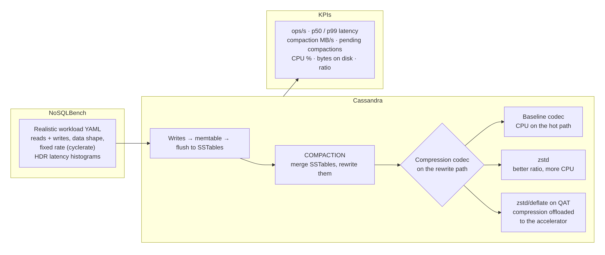

This is your best "bottleneck → change → measure → why" story. **Fill in your real numbers
tonight** in the table below. Do not quote a number you cannot stand behind.

### 6.1 The story in STAR form

**Situation.** Cassandra writes go to a memtable, are flushed to immutable files (SSTables), and
**compaction** later merges and rewrites those files. Every rewrite compresses data again, so
compression runs constantly on the write path. Under heavy writes, compaction fell behind
(**pending compactions** grew), CPU was busy in compression, and write latency rose.

**Task.** Increase sustainable write throughput without hurting tail latency or disk usage.

**Action.**
1. Profiled first: **[fill in: e.g. perf / VTune / flame graph showed X% of CPU in the compression
   codec during compaction]**.
2. Tried **zstd** in place of the baseline codec: better compression ratio (fewer bytes written),
   more CPU per byte.
3. Added **QAT** (Intel QuickAssist) so compression ran on the accelerator, freeing CPU cores for
   request handling and compaction logic.
4. Measured with **NoSQLBench**, not cassandra-stress (§6.2).

**Result.** **[fill in your table below]**, and the **why** (§6.4).

### 6.2 Why NoSQLBench and not cassandra-stress

| | NoSQLBench | cassandra-stress |
|---|---|---|
| Workload | Defined in YAML: your real schema, data distributions, read/write mix | Built-in, simpler workload shapes |
| Load control | Fixed operation rate (`cyclerate`): an **open-loop** style test at a target rate | Mostly "as fast as possible" (closed loop) |
| Latency metrics | HDR histograms, accurate tails (p99, p99.9) | Basic summaries |
| Reuse | Same workload file across runs, versions, clusters | Re-specified each time |

> "I needed to test at a fixed request rate with our real data shape and read the tail accurately.
> With 'as fast as possible' load, the server slows the client down and you never see the queueing
> that users feel. That's coordinated omission, and NoSQLBench avoids it."

**The LLM equivalent:** `vllm bench serve` with a fixed **request rate** is the NoSQLBench-style
test; firing requests in a closed loop is the cassandra-stress-style test. Same lesson.

### 6.3 Your numbers (fill in tonight)

| KPI | Baseline codec | zstd (CPU) | zstd/QAT | How measured |
|---|---|---|---|---|
| Write ops/s at target p99 | [fill in] | [fill in] | [fill in] | NoSQLBench |
| p50 / p99 write latency | [fill in] | [fill in] | [fill in] | NoSQLBench HDR histograms |
| Compaction throughput (MB/s) | [fill in] | [fill in] | [fill in] | `nodetool compactionstats` / logs |
| Pending compactions at steady state | [fill in] | [fill in] | [fill in] | `nodetool` / metrics |
| CPU % (and % in codec) | [fill in] | [fill in] | [fill in] | perf / VTune / sar |
| Compression ratio / bytes on disk | [fill in] | [fill in] | [fill in] | SSTable sizes |
| Runs per config | [fill in] | | | median and spread |

If the headline is the **23% throughput** from your resume (QAT Java library), say exactly which
workload and setup it came from **[confirm]**.

### 6.4 The WHY, in the words to use

1. **Compression was on the hot path.** Compaction competes with requests for the same cores;
   the profile showed CPU time in the codec **[fill in]**.
2. **zstd** wrote fewer bytes (better ratio) → less disk I/O per compaction, but cost more CPU.
3. **QAT** moved that compression work off the cores → cores went back to serving requests →
   higher throughput at the same latency target.
4. **Proof:** CPU time in the codec dropped in the profile **[fill in]**, and pending compactions
   stayed flat at a higher write rate **[fill in]**.
5. **Trade-offs you checked:** offload has a fixed cost per call, so very small blocks may not
   gain; QAT hardware must be present (fallback to software); data compressed by one codec must
   still be readable.

### 6.5 The bridge to LLM inference (say this)

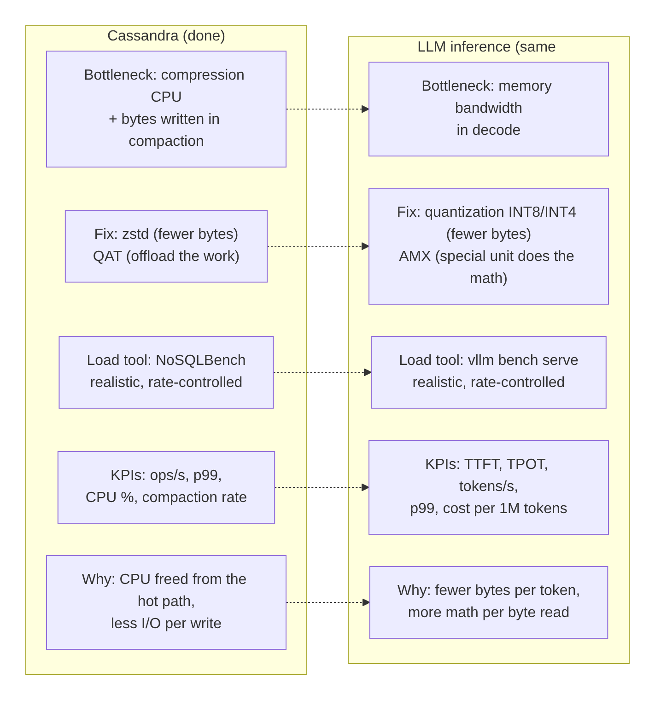

> "It's the same pattern. In Cassandra the bottleneck was compression CPU and bytes written; I
> reduced bytes with zstd and moved work to a specialised unit with QAT, and proved it with a
> rate-controlled load generator and profiles. In LLM decode the bottleneck is bytes read per
> token: quantization reduces the bytes, AMX is the specialised unit for the matrix math, and
> `vllm bench serve` at a fixed rate plus top-down analysis prove the why. I measure the same
> KPIs: throughput at a latency target, the tail, CPU and bandwidth."

---

## 7. Questions you will be asked, with answers

### Fundamentals

**Q: Explain prefill and decode.**
Prefill processes the whole prompt in one pass: matrix × matrix, compute-bound, it sets time to
first token. Decode makes one token per step: it must read all the weights for each token and does
little math per byte, so it's memory-bandwidth-bound; it sets time per output token.

**Q: Why is decode memory-bound? Give a number.**
Each token reads every weight once. A 1.5B BF16 model is ~3 GB; a socket with 8 DDR5-4800 channels
peaks around 307 GB/s, so one user can't exceed ~100 tokens/s even in theory. Batching shares one
read across many users, which is why throughput rises with concurrency.

**Q: What is the KV cache and how big is it?**
Stored keys and values for every past token in every layer. Size per token = layers × KV heads ×
head size × 2 × bytes. For Qwen2.5-1.5B in BF16: 28 KiB; for an 8B Llama-class model: 128 KiB. It
often decides how many users fit, and in decode it's read every step, so long contexts slow decode.

**Q: What does PagedAttention solve?**
Fragmentation. Instead of reserving each request's maximum length, the cache is split into blocks
mapped by a table, like virtual memory, so more users fit and shared prefixes can share blocks.

**Q: Continuous vs static batching?**
Static waits for the whole batch's longest answer; continuous adds and removes requests every step,
keeping hardware busy. The trade-off: more total throughput, slightly slower tokens per user. I
measured 4.35× throughput at 8 users with TPOT up 1.8×.

**Q: Which quantization would you use on Xeon and why?**
BF16 as the baseline with AMX. INT8 (weights and activations) where accuracy holds, because AMX-INT8
and VNNI speed up the math and halve the bytes. INT4 weight-only for decode-heavy, memory-bound
serving: it cuts bytes per token most. Always with an accuracy check next to the speed number.

**Q: What are TTFT, TPOT and goodput?**
Time to first token; time per output token after that; and requests per second that still meet the
latency target. I'd decide on cost per million tokens at a p95 target, not on peak throughput.

### Intel platform and tools

**Q: How would you find the bottleneck of vLLM on Xeon?**
Fair baseline first. Then layer by layer: engine metrics (are requests waiting? is the KV cache
full?), framework (is AMX used: `ONEDNN_VERBOSE`), OS (thread count and pinning, NUMA locality,
`numastat`), hardware (top-down: memory bound vs core bound; bandwidth with VTune or PCM). One
change at a time, re-measure, explain the delta with counters.

**Q: Explain top-down analysis.**
Every pipeline slot goes into Retiring, Bad Speculation, Frontend Bound or Backend Bound; Backend
splits into Memory and Core bound. Start at level 1 and drill into the biggest bucket. Decode
usually shows high Memory Bound; well-tuned prefill shows more Retiring.

**Q: Explain the roofline model.**
Attainable performance = the lower of peak compute and bandwidth × arithmetic intensity. Low-
intensity kernels (batch-1 decode) sit under the memory roof; high-intensity (prefill, big batches)
under the compute roof. Batching and quantization move decode to the right.

**Q: Walk me through how an LLM runs on a CPU.**
vLLM batches requests and keeps a paged KV cache in RAM; PyTorch runs the layers; oneDNN kernels do
the matrix work; OpenMP threads, one per core, each take a slice of every matrix. For every new
token the weights stream from DRAM through the caches, so single-user decode is bandwidth-bound.
Prefill and batched decode are matrix × matrix, which is where AMX helps. Tuning: threads on
physical cores, NUMA-local memory, AMX verified, enough batching, quantization. (§2.13)

**Q: When would you pick a CPU over a GPU for inference?**
Small models (1–8B), modest or bursty volume, latency targets a CPU can meet, very large memory
needs, or where GPUs are scarce. I'd decide on cost per million tokens at the latency target,
measured on both.

**Q: What's AMX and when does it help?**
Advanced Matrix Extensions on 4th Gen Xeon and later: tile registers plus a matrix-multiply unit
for BF16 and INT8 (FP16 on Xeon 6). It helps matrix × matrix work: prefill and batched decode. It
helps little for batch-1 decode, which is memory-bound.

**Q: How does NUMA affect inference?**
If threads on one socket read weights from the other socket's memory, bandwidth drops and latency
rises over UPI. Bind threads and memory to the same node (`numactl`), or run one instance per
socket (or per SNC domain) behind a router.

**Q: Hyper-threading on or off for LLM serving?**
Measure, but for bandwidth-bound decode the second thread usually adds little and can add
contention; I'd pin compute threads to physical cores. That's why I compare per physical core.

**Q: What would you put in a BKC for vLLM on Xeon?**
BF16 weights with AMX verified; threads pinned to physical cores of one socket; memory bound to the
same NUMA node; one instance per socket; KV cache sized from the model and concurrency; huge pages
on; tcmalloc or jemalloc; `--shm-size` or `--ipc host` in containers; recorded CPU frequency
policy. Each item backed by a before/after number.

**Q: When do you use eBPF or ftrace instead of perf?**
perf for CPU hotspots and counters. ftrace and eBPF for OS behaviour: scheduler run-queue delay,
off-CPU time, syscalls, page faults. For example, if TTFT spikes but CPU isn't busy, `runqlat` or
off-CPU analysis shows threads waiting.

### Serving engines and agents

**Q: vLLM vs SGLang vs OpenVINO?**
vLLM: the general reference engine, PagedAttention and continuous batching. SGLang: RadixAttention
prefix sharing and fast structured output, great for agents with many calls sharing prompts.
OpenVINO: Intel's toolkit, tuned for Intel CPUs, GPUs and NPUs.

**Q: How are agentic workloads different to benchmark?**
Many calls per task, so total latency is a sum and TTFT matters; long shared prompts, so prefix
caching matters; tool calls between LLM calls, which must be timed separately; and different steps
suit different models, so routing is part of the design. My triage agent does exactly that: rules
first, a small model for the cheap step, a large model for reasoning.

**Q: How would you benchmark an agent end to end?**
Fixed scenarios, real tools (or recorded responses), per-call timing of LLM and tools, tokens per
call, prefix-cache hit rate, task success rate, and cost per completed task, not per request.

### About you

**Q: You haven't worked on LLM inference in production. Why you?**
> "The hard part of this job isn't knowing what PagedAttention is; it's finding why a number is
> what it is across layers, and I've done that for twelve years on Xeon, the JVM and storage
> engines. I've learned the inference side hands-on: I ran vLLM and llama.cpp myself, sized the KV
> cache from the model, measured batching and explained the result. I'll be productive on method
> and tooling on day one and fast on the model-specific parts."

**Q: Tell me about a time a benchmark misled you.**
Use Finding 1 or 3: batching gave 4.35× not 8× because the client shared the CPUs and vLLM kept a
core; or two identical runs differed by 15%. Lesson: separate the load generator, repeat, report
spread.

**Q: How do you make results trustworthy across teams?**
WSF: one orchestrator, recorded configuration with every result, repeatable runs. In the lab:
every result records commit, dataset hash, model revision, image digest and CPU flags; nothing goes
in a report without a raw file.

---

## 8. What to claim, what not to claim, what to ask them

### 8.1 Claim (true and evidenced)

- Twelve years of Intel performance and benchmarking work; WSF; Xeon validation.
- Profiling with perf, VTune, flame graphs; JVM and lock-contention work; QAT and zstd work with
  measured gains.
- Built and shipped an agentic AI system with MCP tools.
- Ran vLLM and llama.cpp yourself; sized a KV cache; measured batching; found and explained real
  behaviours (core reservation, memory defaults, shared memory, run-to-run noise).
- Measured KV-cache compressibility on a real model and explained the ceiling.
- Studied Intel's Agent Toolkit end to end: its design, decisions, CPU settings and gaps.

### 8.2 Do not claim

- Production LLM serving experience, or measured Graviton vs Xeon results (not run yet).
- Upstream contributions to vLLM or SGLang (unless you have them).
- Specific Xeon bandwidth or AMX speed-up numbers you have not measured. Use the arithmetic and say
  "theoretical peak".
- That you built, contributed to or deployed the Agent Toolkit. You studied it.
- C++ depth you don't have. Say what you've done natively (e.g. JNI/QAT) **[confirm]** and that
  Java is your expert language.

### 8.3 Good questions to ask them

- "Which workloads are you characterizing now: agentic pipelines, or single-model serving?"
- "Where do most of your findings land today: upstream vLLM/SGLang patches, oneDNN, or BKCs?"
- "How do you get counter-level data on customer-like setups: bare metal, EMON in the lab?"
- "How do you decide between a software fix and feedback to the silicon team?"
- "Is the Agent Toolkit the team's main product, and who owns the inference layer: this team or
  another?"
- "Are per-SKU inference numbers for the toolkit planned? Who would publish them?"
- "How is the Hybrid Router tuned today: is `target_tpt` calibrated per platform, and is any
  quality signal used?"
- "What does success look like in the first 90 days?"

---

## 9. One-page cheat sheet

```
GENERATION      predict 1 token → append → repeat
PREFILL         whole prompt, matrix×matrix, COMPUTE-bound  → TTFT
DECODE          1 token/step, reads ALL weights, BANDWIDTH-bound → TPOT
DECODE LIMIT    tokens/s (1 user) ≲ memory BW / model bytes   (307 GB/s / 3 GB ≈ 100)
KV PER TOKEN    layers × kv_heads × head_dim × 2 × bytes      (Qwen2.5-1.5B: 28 KiB)
PAGED ATTN      KV cache in blocks + table = virtual memory for KV
CONT. BATCHING  join/leave every step → throughput ↑, per-user TPOT ↑
QUANT           fewer bytes per weight; INT4 weight-only → decode; INT8 W+A → AMX/VNNI
AMX             BF16 + INT8 matrix unit (FP16 on Xeon 6) → prefill, batched decode
TOP-DOWN        Retiring | Bad spec | Frontend | Backend(Memory | Core); decode → Memory
ROOFLINE        perf = min(peak, BW × FLOP/byte); batching & quant move decode right
CPU INFERENCE   weights in DRAM, streamed every token; threads split each matrix across cores;
                AMX for BF16/INT8 matrix work (prefill, batched decode); batching = catch-up
KNOBS           threads, pinning, numactl, 1 instance/socket, huge pages, tcmalloc, shm
TOOLS           perf/VTune hotspots · TMA/toplev · PCM/MLC bandwidth · ONEDNN_VERBOSE (AMX?)
                Advisor roofline · ftrace/eBPF (runqlat, offcpu) · vLLM /metrics, bench serve
KPIs            TTFT, TPOT, p50/p95/p99, tokens/s, req/s, goodput, $/1M tokens @ SLO, accuracy
YOUR FINDINGS   batching ×4.35 thrpt (not 8: shared CPUs, 1 core reserved, overheads)
                vLLM CPU keeps 1 core · KV default ≈ most of RAM · shm 160 MiB > 64 MiB default
                15% run-to-run swing at c=8 · constrained output 0/65 invalid · VM: no PMU
STORY           Cassandra: compaction codec CPU → zstd (fewer bytes) + QAT (offload)
                NoSQLBench fixed-rate + HDR tails → ops/s @ p99, CPU, compaction MB/s
                SAME AS LLM: quantization = fewer bytes, AMX = offload, bench serve = NoSQLBench
KV COMPRESSION  real Qwen2.5-1.5B: 28 KiB/token; zstd split planes 1.44× (≤1.46× ceiling);
                LZ4 1.00×; exponent predictable, mantissa random → quantize first, compress cold tiers
AGENT TOOLKIT   Intel's agent stack on Xeon: Envoy TLS → LiteLLM → fail-closed guard → Hybrid Router
                (rules + bandit) → vLLM BF16/AMX, NUMA-pinned (NRI) → Langfuse
                knobs: KVCACHE_SPACE, NUM_OF_RESERVED_CPU, block-size 128, prefix caching, specdec
                gaps: NO published inference numbers (measure 4 paths, find knee, WSF-style harness)
                router reward target_tpt=1.0 → CPU models all ≈0.9; speed-only → add quality signal
```

Good luck. Slow down, draw the prefill/decode picture on the whiteboard, and end every answer with
**why**.
